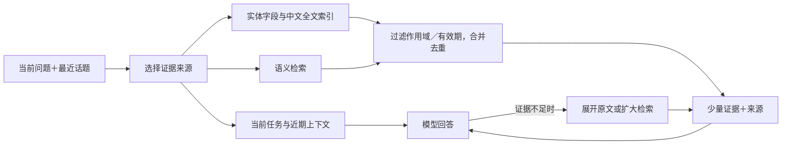

# INV-28 · Momo 四方向更新调研与修改大纲

日期：2026-10-23。目标：先自用，按商业产品质量建设。范围：任务 1、3、5、2；本文件给出候选修改设计与验证顺序。承接 [INV-25](INV-25-commercial-assistant-research.md) 的产品/架构分析和 [INV-27](INV-27-lifecycle-and-regression-gates.md) 的工程收尾。

2026-11-17 后续：用户要求先评估继续改造还是按新框架重搭。当前能力与架构建议见 [ARCH-001](product/ARCH-001-runtime-renewal.md)，最新证据见 [INV-29](INV-29-global-architecture-review-2026-11.md)。本文保留 10 月技术调查；§7 批次属于当时建议，当前排期以 ROADMAP 为准。

## 1. 本轮结论与新证据

建议继续使用 React/Tauri + FastAPI/SQLite/LiteLLM，在现有调用链上推进：**需求发现与资源/费用基线同步开始 → 记忆可靠性和中文检索 → 按需上下文与资源释放 → 一个真实日用任务 → 人格表达、技能复用与语音体验持续改进。** 任务 2 的表达试验可早做，语音原型也可独立探索；它们不必等待其他方向全部结束。

本轮比上次调研更具体的依据：

1. 本机 `sysctl` 返回 **Apple M2、8 GiB RAM**。以后先按这台设备制定常驻预算，替代 INV-25 中用于讨论的 16 GB 假设。
2. 当前检索为本地遍历已存向量后取 Top 5，主要问题是短句漏召回、证据来源粒度、相关性和随规模增加的本地开销；聊天模型未读取整个记忆库。
3. 提取出的多条事实统一关联到批次最后一条用户消息。要实现“打开记忆原话”，需要每条事实携带真实来源，并由程序核对来源属于该输入批次。
4. 已有流式 usage/cache 记录，应继续复用；请求侧 Token 分层探针仍使用固定模型名及文本标记解析，需要改为结构化分层记录并关联每次调用。
5. 在 7 条合成中文记录上实际比较了三种 SQLite FTS5 索引方式：原样 unicode61 和 trigram 都漏掉“张三”“相机”等两字检索；预分词双字索引可命中，但无法解决“上次那个”或事实归属。结果直接支持“中文分词 + 近期话题 + 语义补充”的组合。
6. 外部资料复核包括 MaiBot 10 月 20 日更新的配置文档、Hermes 记忆/技能/工具搜索、LiveKit 回合处理、Apple/PixiJS 内存方法、中文全文索引及长期记忆评测。完整来源见 [资料登记](research/assistant-upgrade-sources-2026-10-23.md)。

本地 HEAD 为 `00a164da`，工作区含任务 4 的未提交修改。此次没有完整启动 Momo 或访问用户聊天库、邮箱和模型账户；执行了硬件查询与独立 SQLite 合成实验。已完成的 CPU 采样、生命周期清理、批次编码复用按 INV-27 保留，后续以当前源码继续改进。

## 2. 当前代码与修改入口

| 主题 | 本轮核对的当前行为 | 修改入口 |
| --- | --- | --- |
| 资源采样 | 复用 CPU 采样对象；RSS 只覆盖后端 | [system.py:110](../references/SOURCE-REFERENCES.md#source-e596941acb)、observability_api、SystemPanel |
| 启动与历史 | embedding/Whisper 主动预热；逐历史会话桶恢复窗口 | [main.py:260](../references/SOURCE-REFERENCES.md#source-df5184bf1f)、[main.py:374](../references/SOURCE-REFERENCES.md#source-df5184bf1f)、short_term.py |
| 就绪条件 | embedding/Whisper/WS/Live2D 四路真实 gate | [useLoadingSequence.ts:97](../references/SOURCE-REFERENCES.md#source-d8e6548303) |
| 提取写入 | None 后外层仍推进游标；保存时使用批次最后 turn ID | [extractor.py:366](../references/SOURCE-REFERENCES.md#source-9abb47cb4b)、[extractor.py:437](../references/SOURCE-REFERENCES.md#source-9abb47cb4b) |
| 记忆读取 | 短输入跳过；全候选向量打分；聊天通常 Top 5 | [long_term.py:289](../references/SOURCE-REFERENCES.md#source-521d60a11a)、[chat.py:1612](../references/SOURCE-REFERENCES.md#source-6a784c600a) |
| 工具上下文 | MEMORY_TOOLS 与注册目录合并；静态补充说明常驻 | [chat.py:593](../references/SOURCE-REFERENCES.md#source-6a784c600a)、tool_addendum.py、tools/registry.py |
| 用量观测 | 已请求 include_usage、记录流末 usage；分层估数依赖固定模型/标记 | [chat.py:2179](../references/SOURCE-REFERENCES.md#source-6a784c600a)、[chat.py:2267](../references/SOURCE-REFERENCES.md#source-6a784c600a)、[_token_probe.py:38](../references/SOURCE-REFERENCES.md#source-07475b223f) |
| 语音 | 已有 turn ID、打断和 TTS 取消；audio:true、WAV/base64 播放队列 | [ws.py:676](../references/SOURCE-REFERENCES.md#source-5220959ddd)、useAudio.ts、useWebSocket.ts、ttsAudio.ts |
| 人格与主动性 | 已有 Persona、Jinja 模板、proactive、角色状态/偏好/生活线 | prompt/renderer.py、proactive/engine.py、services/character_fsm.py；功能状态见 [PROJECT-MAP](PROJECT-MAP.md) |

## 3. 任务 1：日常实用性

### 3.1 研究判断

日常价值应落在少数经常复用的完整事务上。Raycast 的工具与确认描述展示了把应用动作接给 AI 的方式；Apple Shortcuts 可由命令行接收输入、输出文件；Playwright MCP 可使用结构化页面快照和持续登录会话。这些提供了 Momo 复用现有应用能力的路径。[Raycast Tool](https://developers.raycast.com/api-reference/tool)、[Shortcuts CLI](https://support.apple.com/guide/shortcuts-mac/run-shortcuts-from-the-command-line-apd455c82f02/mac)、[Playwright MCP](https://playwright.dev/docs/getting-started-mcp)

### 3.2 修改大纲

| 修改项 | 具体内容 | 现有基础与交付物 |
| --- | --- | --- |
| A1 需求发现 | 每轮围绕一个近期真实任务，询问当前步骤、频率、最烦之处、期望结果与自动化程度；形成约 3 张场景卡 | 更新日常助手 PRD；标明用户原话、候选、选择与验收 |
| A2 统一任务入口 | 在助手卡中接收文字、文件或选定内容；只询问执行所缺的信息 | 复用 ChatInput、附件/读屏能力；给出来源与结果入口 |
| A3 执行状态 | 为首个多步骤任务保存目标、当前步骤、外部结果 ID、状态、错误及恢复位置 | SQLite 中增加最小 task run 记录；复用 WS 事件与确认门，不另建通用工作流平台 |
| A4 接入选定应用 | 按场景采用官方 API、OS 接口、已有 MCP、浏览器；确定性步骤复用代码或快捷指令 | 每个连接器只交付首个场景必需的读取/写入/结果核验 |
| A5 持续跟进 | 时间明确的提醒进入结构化调度；需要理解变化的事务才调用模型 | 复用 scheduler；定义编辑、取消、补发和避免重复通知 |
| A6 模型连接体验 | 在现有 Provider 配置上显示已验证的工具/视觉/流式能力、连接状态、费用统计 | 复用 LiteLLM 与 AIProvidersSection；按模型任务能力选择，不只按名称切换 |

候选场景供访谈比较，不预设邮件优先：

| 场景 | 一个可以落地的首版任务 | 接入与验证重点 |
| --- | --- | --- |
| 资料/消息处理 | 给一份文件或网页，提炼关键内容和待办草稿 | 复用当前附件/URL 能力，验证原文依据和用户修正量 |
| 提醒与跟进 | 创建、修改、延后一个明确提醒 | 用户关掉界面、退出、休眠时分别验证；系统日历事件和 Reminders 分别接入 |
| 邮件 | 指定范围的摘要或回复草稿 | 先确定服务商；增量同步、原邮件链接和草稿核验 |
| 文件整理 | 为指定文件夹生成分类/重命名方案并执行选中部分 | 路径与覆盖语义、撤销清单和结果检查 |
| 浏览器事务 | 在一个常用网站完成查找/填表流程 | 稳定登录会话、结构化定位、页面变化与提交结果 |
| 每日回顾 | 汇总用户允许的来源、未完成事项与明日准备 | 时间范围、去重、打扰时机和来源可追溯 |

**建议的首个演示候选**：用户选择一份材料 → Momo 提炼重点和候选待办 → 用户纠正/选中 → 保存结果；若用户最痛的是提醒或邮件，则换成对应任务。现有附件/网页能力使这个演示接入较轻，价值仍由用户真实事务决定。

两项选型细化：

- Gmail 官方对安装在用户设备上的客户端推荐同步拉取路径；首个自用版本可从增量同步与退避开始，不必默认建设 Pub/Sub 服务。历史游标失效时重建同步状态。Microsoft Graph 也有 delta 查询。[Gmail 同步](https://developers.google.com/workspace/gmail/api/guides/sync)、[Gmail 推送适用范围](https://developers.google.com/workspace/gmail/api/guides/push)、[Graph delta](https://learn.microsoft.com/en-us/graph/delta-query-overview)
- 浏览器能复用持续 profile；自动化自己启动的浏览器可以按需释放，连接用户现有浏览器时只管理自己的连接。对已授权的操作按原授权执行，需要新确认时展示具体参数；结果未知的外部写操作先查询结果再决定重试。

### 3.3 验收

选定一个任务族，先记录约 10 次真实使用：是否完成、净省时、接管次数、失败原因、是否愿意再次使用。技术样例同时覆盖断网、重启和重复请求。产物是可使用的任务结果与清楚的失败状态；初期无需搭建付费、组织和多租户系统。

## 4. 任务 3：适合 M2 / 8 GB 的 RAM 优化

### 4.1 测量与选型

现有后端 RSS 看不到完整应用。建议增加按归属记录的资源采样：Python、Tauri、WebView/WebContent、MCP 子进程及本应用启动的模型/浏览器服务。WebKit 进程未必是直接子进程，不能仅递归 PPID；记录归属确定程度，无法确定者单列。RSS 分项用于对照，配合系统压力、压缩/swap 和 Instruments footprint 解释共享页。[Apple 内存分析方法](https://developer.apple.com/library/archive/technotes/tn2434/_index.html)

本机基线：同一构建、模型、角色与工具列表，冷/暖启动，空闲 10 分钟，文字 20 轮，语音及打断，切角色 30 次，连续使用 2 小时。保留原始采样，比较相同状态的稳定值、峰值和恢复时间；先得到预算，再锁定默认运行档位。

### 4.2 修改大纲与取舍

| 顺序 | 修改 | 为什么优先/何时采用 | 代价与验证 |
| --- | --- | --- | --- |
| R1 | 完整进程归属采样与场景记录 | 为各方案提供统一比较依据 | 采样自身开销控制在低频；分清系统总内存与应用内存 |
| R2 | 历史只恢复当前会话，其他首次访问再载入；热窗口设置总量上限 | 当前启动按全部历史桶恢复，历史增长时会放大常驻量 | 用 1/100/1000 会话的合成库比较；切换后原文、摘要与顺序一致 |
| R3 | 模型按使用加载，空闲后可释放 | 纯文本期间无需一直驻留语音模型 | 明确“界面可交互/语音准备中”；首次语音延迟单列；加载中的调用共用同一任务 |
| R4 | 音频队列按秒数/字节数限制，消费后释放；角色纹理按所有权释放 | 限制长回答、重播、切角色的峰值与残留 | 队列满时先背压/减速生产，避免任意丢正文；共享纹理不能误销毁 |
| R5 | 连接器与自动化浏览器按需连接/空闲关闭 | 降低不用时的子进程占用 | 保留必要的事件订阅；重连延迟、会话恢复、关闭归属分别验 |
| R6 | ASR/embedding 后端对照 | 模型/runtime 仍是主要开销时再做 | 同中文语料和任务比较，不单看内存 |

R3 会改变目前四路 appReady 契约，应作为明确的能力状态变更单独设计：保留真实 boot marks，未加载显示未加载；传统全部预热模式仍可保留。它不并入视觉或行为保持型瘦身改动。

R6 候选：

- **现有 faster-whisper CPU int8** 作为基线。当前 `_compute_type` 已在 CPU 选择 int8，不把“开启 int8”重复列为新优化。官方基准显示 batch 与量化会改变内存/速度，但其 Intel 数据不直接决定这台 M2 的结果。[faster-whisper](https://github.com/SYSTRAN/faster-whisper)
- **whisper.cpp / Core ML** 做一个 ASR 适配器原型。官方支持 Apple Silicon 的 ANE encoder；首轮编译、中文准确率、专名和冷启动都纳入比较。[whisper.cpp](https://github.com/ggml-org/whisper.cpp)
- **embedding 的 ONNX 后端** 可作对照。需要同时检查 import 后的基础内存和依赖；仅改 backend 参数不能作为已移除 PyTorch 常驻成本的证据。[Sentence Transformers](https://www.sbert.net/docs/sentence_transformer/usage/efficiency.html)
- 若对象释放后仍有明显 native 内存驻留，再考虑独立模型进程。CTranslate2 描述了对象删除释放资源，但 Translator 的卸载接口不能未经核对套给 Whisper。[CTranslate2](https://opennmt.net/CTranslate2/memory.html)
- 前端使用 PixiJS 7，应按对应版本检查 texture/base texture 的共享与销毁，避免套用新版不同 API。[PixiJS 7](https://pixijs.com/7.x/guides/production/performance-tips)

### 4.3 验收

先实现一个测量切片，再挑最大来源优化。每项交付空闲/峰值/回落数据及首次响应代价；重复切换后曲线趋于稳定。只有本机体验和数据支持时才切默认。INV-25 的 800 MiB/2.5 GiB 是讨论示例，本轮不沿用为 8 GB 机器的硬门槛。

## 5. 任务 5：记忆、上下文、Token、工具与语音

### 5.1 记忆数据设计：有原话，也有可定位的事实和事件

保留现有 SQLite，先补四种责任：

| 材料 | 内容与写入方式 | 读取方式 |
| --- | --- | --- |
| 当前工作上下文 | 最近话题、未完成任务、当前更正；随当前任务更新 | 近期窗口＋小型任务状态 |
| 稳定事实 | 明确的个人事实/偏好，附实体、有效时间、来源、作用域 | 实体/字段索引优先，语义检索补充 |
| 话题与事件 | 聊过什么、考虑过什么、发生过什么；增量分段，必要时短摘要 | 时间/关键词/语义定位，展开关联对话 |
| 对话原文 | 保留说话者、会话、时间与原始内容，按用户保留设置管理 | 查证与展开；不每轮全部注入 |

提醒、外部动作状态仍进入任务/调度数据。角色虚构经历与真实用户事实保留各自作用域。

随口信息的产品规则：

- “我家猫叫 Mochi”：一次明确陈述就可保存稳定事实，无需反复确认。
- “猫粮哪种好”：保存为聊过的话题，不据此认定用户养猫。
- “今天好累”：近期临时状态；需要持久化时带有效期。
- “我朋友住杭州”“假如搬去杭州”：保存第三方关系或假设，不能更新用户地址。
- “最近考虑买相机”：带日期的考虑中事件，后续可以被回忆。
- “不对，现在是……”：写入更正并更新当前上下文；旧事实保留历史有效区间。

### 5.2 写入修改：可靠、可追溯、增量处理

**M1：修提取结果与失败状态。** 返回结构化结果，区分成功无事实、调用失败、解析失败、写入失败。增加小型持久提取作业记录（来源范围、版本、状态、尝试次数、下次重试）；扫描可前进，但失败批次先落库，能在重启后重放。以来源范围/版本作幂等键，部分写入失败不会重复生成事实。现有“失败后前进避免卡死”的活性目标保留。

**M2：逐条来源。** 提取输出包含每条事实的 source_turn_ids；程序检查 ID 属于输入批次，记录对应文本证据。合法 ID 仍可能配错句子，评测中要核对事实是否得到原文支持。不能继续把批次最后一条消息作为所有事实的精确来源。新增精确来源关系；旧数据标为旧批次来源，不虚构逐条映射。

**M3：话题片段索引。** 先对既有聊天历史做按会话/时间/长度的确定性分段和全文索引，不要求每段先花 Token 总结；只对活跃话题、超过窗口的相关片段增量摘要。embedding/摘要按内容版本更新，失败单独回填。更正和删除同时影响索引、摘要引用与缓存。

### 5.3 读取修改：低 Token 找到对应记忆

**M4：替换短句长度门。** 明确问候可不查；“我猫叫什么”“上次那个”按最近话题与实体检索。规则先覆盖明确情况，不确定时才一次小预算改写；多种解释都成立时询问用户。

**M5：中文混合检索。** 比较三档：现有向量 Top 5；中文分词 FTS＋实体/时间索引；FTS 与向量并行召回后融合。不要先以关键词命中作唯一候选再算向量，否则同义表达会丢失。小库保留精确向量比较；规模实测需要时再试 ANN。检索数量与给模型的数量分开管理。

**M6：两段式读取。** 普通问题由程序直接返回相关事实和来源。复杂回忆先返回少量片段标题、时间与短摘要，再用 `read` 展开原文；不要每轮让模型先读完整记忆目录。候选池试用 10～30 条，普通问题最终取约 2～5 条、300～800 Token 新增记忆的软预算；长时间线任务按证据需求另设档位。这些是实验参数，不强制凑满条数。

索引实现可先用 SQLite FTS5；中文分词/双字索引需单独处理，单靠默认 tokenizer 不够。[SQLite FTS5](https://www.sqlite.org/fts5.html)

### 5.4 本轮已做的中文检索小实验

独立脚本 [fts5-probe](../references/SOURCE-REFERENCES.md#source-923c9d39d0) 在内存 SQLite 3.53.0 中插入 7 条合成记录，未加载模型或访问用户数据库。结果见 [JSON](../references/SOURCE-REFERENCES.md#source-68883498a1)。

| 查询 | 原样 unicode61 | trigram | 预分词 2gram |
| --- | --- | --- | --- |
| 张三 / 相机 / 上海 / 猫粮 | 这些样例均无匹配 | 这些两字查询均无匹配 | 均找到含对应文字的记录 |
| Mochi | 本例中与中文连写，未匹配 | 命中本人和朋友两条记录 | 命中本人和朋友两条记录 |
| 上次那个 | 无匹配 | 无匹配 | 无匹配 |

由此作出三个设计判断：中文要准备索引词；同名命中后仍需判断实体归属/断言性质；指代问题需要近期话题或查询改写。实验仅检验匹配机制，没有测语义模型质量和大库耗时。最终 tokenizer 比较增加 jieba/混合词、专名和噪声样本。

### 5.5 上下文与费用修改

**C1：结构化 Context Builder。** 每个片段在生成时附 layer、source、priority、token estimate，不再事后猜文本标记。按当前模型上下文上限扣除输出预留，装入规则、角色、当前任务、近期对话、检索证据和工具。保持完整 tool call/result 配对；大结果分页或保存后按需读取。

**C2：统一调用账本。** 基于现有 include_usage/cache 指标，增加 task/turn/call ID、实际模型、调用目的、耗时和估算/实际用量标签；摘要、提取、改写、重试、TTS/ASR 都能汇总。usage 缺失记 unknown 或估算，不作零消费。价格表按用户端点/计价日期配置，LiteLLM 的标准价格辅助估算。[LiteLLM usage](https://docs.litellm.ai/docs/completion/token_usage)

**C3：按需工具目录。** 保留 registry 与现有执行门禁，给工具补短描述、用途标签和搜索词。常用小工具集直接暴露，其余按任务选择/搜索加载；低置信度可扩大目录。tool_addendum 改为通用短规则＋相关工具说明，能力开放状态从真实目录取得。对自用初期无需另建大型工具平台。

Hermes 的桥接搜索保留实际工具调用路径；Claude 也提供供应商原生延迟工具加载。两者可作实现参照，但原生 `defer_loading` 有其 API 契约，不直接作为 LiteLLM 通用参数。[Hermes Tool Search](https://hermes-agent.nousresearch.com/docs/user-guide/features/tool-search/)、[Claude Tool Search](https://platform.claude.com/docs/en/agents-and-tools/tool-use/tool-search-tool)

**C4：缓存与会话边界。** 稳定规则/角色前缀与动态事实分开；当前更正立即进动态部分并使对应缓存失效。自然话题结束时形成可恢复任务摘要，避免一个会话持续滚大。切工具集可能改变缓存命中，比较每个正确完成任务的总成本和延迟。[OpenAI Prompt caching](https://developers.openai.com/api/docs/guides/prompt-caching)

费用口径：同一周期所有交互、后台、失败尝试的费用总和 / 成功任务数；没有成功任务时直接报告总支出。省了首轮输入但多出数轮搜索，未必节省最终费用。

### 5.6 语音修改与全双工探索

当前已有打断与取消链，建议在此基础上补齐：

| 修改 | 做法 | 验收 |
| --- | --- | --- |
| V1 轮次与播放一致 | 全链携带 turn/generation ID；拒收旧轮迟到音频，记录已播位置和未播内容 | 打断后无旧语音回流；保存的对话能解释实际说到哪里 |
| V2 区分停止与误打断 | 保留“停一下”明确抢话；对“嗯”、咳嗽、外放回声做检测；必要时恢复播放 | 误打断/漏打断率、中文词丢失、外放与耳机分别记录 |
| V3 首音频与队列 | 分句/流式 TTS 按 provider 能力接入，有序消费与背压 | 从用户说完到首音频、停播延迟、长回复峰值 |
| V4 全双工原型 | 现有 ASR→LLM→TTS、LiveKit 编排、原生实时音频/Moshi 类路线用相同对话对照 | 重叠语音、附和、中文、角色音色、工具操作、费用/RAM |

LiveKit 将回合结束、打断策略与误打断恢复拆开；OpenAI VAD 区分静音与语义判断。可借鉴相应控制点。Moshi 提供完整双向语音模型路线，可用作全双工原型参照。[LiveKit options](https://docs.livekit.io/reference/agents/turn-handling-options/)、[Realtime VAD](https://developers.openai.com/api/docs/guides/realtime-vad)、[Moshi](https://github.com/kyutai-labs/moshi)

当前流水线保留已有角色音色和工具接入，适合先改善打断；原生音频路线的潜力通过小原型验证。原型安排可与其他工作并行，默认切换由体验结果决定。外部写操作一旦发出，语音取消后的结果也要核对。

## 6. 任务 2：MaiBot / Hermes 借鉴大纲

### 6.1 上游复核

2026-10-23 读取 GitHub 默认分支元数据：

- MaiBot main：`c602a2780f4f4dda4a6be46d67abc1cfb1ad420c`，提交 2026-10-21 UTC，GPL-3.0。
- Hermes main：`a01edde680a73fdcabc2aa20b94d0581338e499b`，提交 2026-10-22 UTC，MIT。

本轮以官方文档和仓库元数据作机制调查；未安装运行竞品。来源登记提供快照链接，实施复用代码时再锁定具体文件与许可。

### 6.2 MaiBot：人格、参与时机、表达与情景记忆

官方将人格、行为方式和回复风格分开，并提供按范围管理的表达学习；A_Memorix 包含中文稀疏检索、事件摘要及增量处理机制。[MaiBot 配置](https://docs.mai-mai.org/manual/configuration/bot-config)、[A_Memorix](https://docs.mai-mai.org/manual/configuration/amemorix-config)

Momo 修改建议：

1. 在现有 Persona 中明确“身份/措辞/参与条件”，通过 renderer 和 proactive 读取；复用已有状态机、偏好与生活线，避免再造一套人格运行时。
2. 助手卡保留自然表达，任务结论、时间与执行状态直接使用真实结果。专注、失败、提醒和闲聊采用不同表达节奏。
3. 先准备 20～30 组精选表达样例，每次只加载少量相关样例；用户可修改/停用。后续自动学习先产生候选，是否自动启用由用户设置，避免每次闲聊额外多调用一个“表达导演”。
4. 记忆借鉴中文检索和事件分段；不默认复制图谱、全量画像刷新和每次检索后的后台反思。具体复杂机制可在出现对应失败后单独对照。

### 6.3 Hermes：有界记忆、技能和低成本自动化

官方常驻记忆使用有界会话快照，历史可搜索；技能按需加载；定时任务可选择无 LLM 的脚本执行。[Memory](https://hermes-agent.nousresearch.com/docs/user-guide/features/memory/)、[Skills](https://hermes-agent.nousresearch.com/docs/user-guide/features/skills/)、[Cron](https://hermes-agent.nousresearch.com/docs/user-guide/features/cron/)

Momo 修改建议：

1. 保持 SQLite；借鉴“少量稳定内容＋按需历史”，当前会话的事实更正用动态更新立即生效。
2. 先把用户反复使用的 2～3 个成功任务整理为版本化技能：用途、输入、步骤、所需工具、完成证据。工具权限仍从执行层取得。
3. 技能初期可用 Markdown/YAML＋轻量索引，匹配时加载；先人工整理，再从成功记录生成候选。保留禁用与上个版本，避免一次失败经验固化。
4. 固定提醒和已确定动作直接调度；有新内容要判断时才使用模型。后台反思默认按明确目的与预算启动，不随每轮对话无限增长。

这两条路线都能在现有模型上试验。若精选样例、检索和提示结构调整后仍有稳定的风格/行为缺口，再用固定样本评估微调收益。

### 6.4 体验验证

同任务同事实，随机顺序比较当前与候选表达：自然、清楚、角色一致、是否打扰。技能评测用同类新任务检查省下的步骤和完成率；事实/执行正确性与表达评分分别记录。用户偏好直接决定采用哪种风格。

## 7. 建议修改批次与交付顺序

以下为建议实施切片，用户选定后再进入 ROADMAP。改动规模为相对判断，实际耗时取决于场景与模型接入。

| 批次 | 内容 | 交付结果 | 依赖 / 规模 |
| --- | --- | --- | --- |
| P0-A | A1 需求发现；R1 资源基线；C2 用量记录补全 | 场景卡、M2/8 GB 资源图、每轮/后台成本记录 | 可同步；中 |
| P0-B | M1/M2 提取失败重放与逐条来源 | 一条事实可追溯、故障后可重试、重复处理不重复写入 | 不依赖最终日常场景；中 |
| P1-A | M3/M4/M5/M6 中文索引、话题指代与渐进读取 | 一组低 Token 记忆问答，含随口信息、纠正、无答案 | 基于 P0-B；中高 |
| P1-B | C1/C3/C4 上下文、工具目录与缓存 | 相关上下文/工具按需装配，费用可比较 | 基线＋固定任务集；中 |
| P1-C | R2/R3/R4 按占用排序优化 | 当前会话按需恢复、模型能力状态、资源回落对照 | 由 R1 确定先后；中高 |
| P1-D | A2～A5 首个日用任务 | 一条真实事务从输入、执行到结果可用 | 场景选定；中，连接器影响较大 |
| P2-A | Persona 分层＋少量表达样例 | 自用偏好明确、表达体验提升 | 可提前小试；小中 |
| P2-B | 2～3 个技能与定时复用 | 同类事务减少重复指挥 | 已有成功日用任务；中 |
| P2-C | V1～V3 打断与流式播放；V4 原型 | 可靠语音交互＋全双工路线对照 | 打断可先做，原型范围独立；中高 |
| 按数据追加 | R5/R6、ANN、图记忆或复杂编排 | 解决已测出的资源/检索/工作流瓶颈 | 各做一个小对照再选；不预先全量迁移 |

**第一批建议实际修改的范围：P0-A + P0-B。** 需求沟通与工程基线同步；工程部分先用现有表、日志与 worker 扩展。随后选择中文记忆读取或首个日用任务作为主线，避免多项行为变化同时上线而难以判断原因。

## 8. 验证与交付约定

- **记忆：**先建立约 40 条中文行为样例，覆盖稳定事实、随口事件、短指代、更正、跨会话、第三方、假设、无答案与删除。结合 LongMemEval 的信息提取、跨会话、时间、知识更新、拒答维度；加入 Momo 自己的角色范围与删除契约。[LongMemEval](https://github.com/xiaowu0162/LongMemEval)
- **任务与工具：**约 20 条首批任务/工具样例，加入结果未知、权限变化与重启；核对外部结果和接管次数。模型路径有随机性，关键样例重复运行，费用与耗时一起报告。[Agent evals](https://www.anthropic.com/research/demystifying-evals-for-ai-agents)
- **资源：**每次只改变一个主要因素，同机同任务 A/B；早期先报原始数据/中位数，样本充足后再报 P95。不要把 embedding 请求数下降换算成未经测量的 RAM 降幅。
- **语音与角色：**自动回归覆盖事件与队列，真机覆盖外放/耳机、长停顿、噪音、切角色和体感；每个切片只验相关项。
- **文档：**INV 保存调查与实验；场景选定后更新独立 PRD 与 ROADMAP；入口/状态变化同步 PROJECT-MAP。需求变更记录原因和受影响验收项。

本轮交付为本调查、来源登记、中文 FTS 合成脚本及结果。没有修改产品运行时代码、config.yaml 或用户数据，没有 commit/push。下一步已能按上述批次形成具体实施规格。
