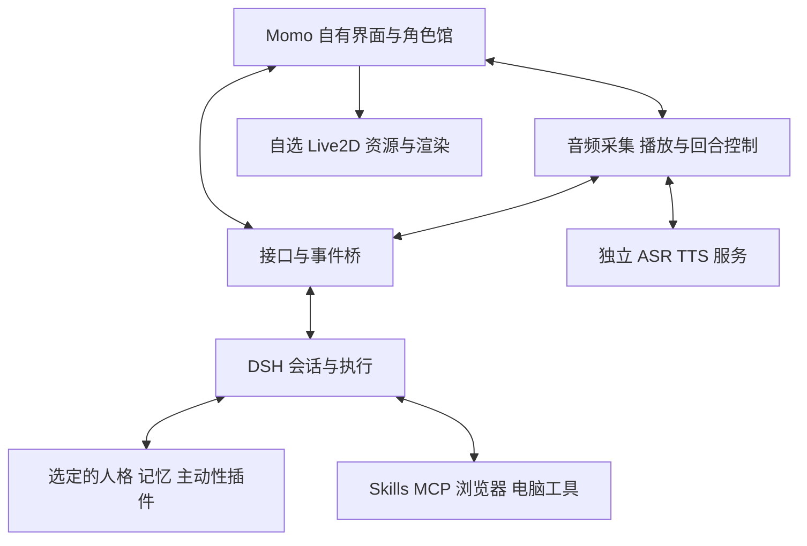

# INV-34 · DSH、大肥鱼生态与 Momo 复用评估

**2026-11-18 候选覆盖纠偏：**本报告没有先核对社区热度，列出的 Identity、AuraKaliya、Life、mizuki Pet 不能代表热门养鱼项目。热度复核及遗漏的重要上游见 [INV-35](INV-35-fish-ecosystem-popularity-audit.md)。保留本文功能调查，但撤回基于这组有限样本的主项目优先顺序；DSH底座决定不变，二开仓库未选定。

核对日期：2026-11-18。状态：官方文档、包声明与关键源码调查完成；未安装候选、未调用模型或平台账号、未运行集成及性能测试。本文是选型依据，不是已迁移清单。需求主入口继续使用 [现有 PRD](product/PRD-momo-next.md)。

**研究后的用户决定：**已选择DSH底座，暂不写代码；人格采用稳定内核+可塑造方向。能力工作表与旧设计取舍分别见PRD v0.22 §2.7、§6.3。下文“优先验证/未选定”保留本调查形成时的状态，最新建设决定以PRD与ARCH-001文首为准，研究证据不因此变成集成验收。

## 1. 本轮结论

优先验证 **DSH 运行底座 + Momo 自有交互与业务插件**。底座已有模型/工具执行、会话、Skills、MCP、调度等机制，Momo 无需预设全部自研。大肥鱼是不同作者围绕角色陪伴、成长和社交开发的一批项目，不是一套统一 SDK；选择其中适合的模块或机制，不把全部插件叠加。

独立前端、自选角色与 Live2D 有明确实现路径，不需要使用大肥鱼外观或完整 DSH 页面。主要适配工作集中在前端桥接、取消与语音、人格/记忆规则、模块管理和旧数据迁移。使用 DSH 运行底座与让 Momo 委派另一套成品主智能体是不同关系：本候选让 Momo 自身运行在 DSH 上。

本轮不将 DSH 记为最终已选框架；研究方向已扩大到运行底座复用。也不因采用底座取消既有十项能力、单角色优先、正式前端后置和人格内容最后讨论等决定。

### 复用分级

- **A：已有接入候选。** 有明确包/接口/实现，优先配置和集成；还需在所选版本及本机验证，不能称为 Momo 已可用。
- **B：需要二开。** 有可用机制，但渠道、数据、行为或界面不同，需要适配。
- **C：本轮未发现满足完整需求的现成实现。** 需要另选专用组件并开发整合，不表示世界上不存在其他方案。

## 2. DSH 已经能承担什么

DSH 是基于 Cordis 的插件化运行环境；模型适配、工具注册、会话日志和 Agent loop 都可通过组合配置。底座不绑定某一个大肥鱼人格。[官方架构](https://github.com/deepseek-ai/deepseek-harness/blob/master/docs/architecture.md)

本轮官方master快照 `ca33fd6843b205e279c7ccb6cb73a472c78f5760`；发布列表最新取得 [dsh-v0.2.2-rc.4](https://github.com/deepseek-ai/deepseek-harness/releases/tag/dsh-v0.2.2-rc.4)，北京时间2026-11-18 01:53，prerelease。下列能力依据当前源码/文档，不保证每项都已在该发行包或旧插件支持范围中。使用DSH不等于固定使用DeepSeek模型：模型provider可配置，具体模型功能仍逐个核验。

| 机制 | 当前证据 | Momo 的复用判断 |
| --- | --- | --- |
| 模型、Agent loop、工具、会话记录 | 官方架构与 packages 分组 | A；选一个主运行底座，避免无理由再套另一个完整执行框架 |
| Skill 发现与渐进加载 | 名称/描述目录与正文加载分离；可读项目、用户、自定义目录；工具支持直接指定技能 | A；可复用加载机制；每个外部技能仍需核对脚本、工具名、账号和依赖 |
| MCP 工具和资源 | stdio、Streamable HTTP；动态管理与资源读取；`toolLoading: on-demand` 可按需装载工具 | A；不保证所有 MCP 功能，当前不支持 MCP prompt templates；目录按需加载不等于子进程按需启动 |
| 定时提醒 | 创建、修改、暂停、恢复、删除；时间规则、会话投递和记录 | A/B；复用调度，Momo 的通知/语音闹铃/错过提醒行为仍需定义；已投递指令不等于任务已完成 |
| 浏览器操作 | Playwright MCP、Chrome DevTools MCP、Stagehand 三类可选 provider | A/B；实验性、显式启用，一套组合只能挂一个 provider；登录与浏览器状态并非都随会话恢复 |
| 电脑操作 | 原生 macOS/Windows CUA：应用/窗口、辅助功能树、截图与输入 | A/B；可复用执行器，仍需目标应用、权限、取消和结果验证；不等于已具备通用游戏能力 |
| workflow | 脚本编排、分派子任务 | A/B；上游术语指脚本化编排，不自动等同于 Momo 全部长期业务流程 |
| 长期个人记忆 | 提供记忆 MCP 接入示例 | B；底座不替用户安装数据库/Embedding，也不自动决定记忆写入、遗忘与纠正 |

证据：

- [Skills 子系统](https://github.com/deepseek-ai/deepseek-harness/blob/master/docs/subsystems/skills.md)、[实际目录/加载实现](https://github.com/deepseek-ai/deepseek-harness/blob/master/packages/skill/tool-skill/src/index.ts)：会话目录记录 name/description，并注册加载工具。
- [MCP 客户端](https://github.com/deepseek-ai/deepseek-harness/blob/master/packages/mcp/mcp-client/README.md)、[配置源码](https://github.com/deepseek-ai/deepseek-harness/blob/master/packages/mcp/mcp-client/src/index.ts)、[管理器](https://github.com/deepseek-ai/deepseek-harness/blob/master/packages/mcp/README.md)。
- [调度用户文档](https://github.com/deepseek-ai/deepseek-harness/blob/master/docs/user/guide/schedule.md)、[调度实现](https://github.com/deepseek-ai/deepseek-harness/blob/master/packages/schedule/schedule/src/index.ts)。
- [浏览器子系统](https://github.com/deepseek-ai/deepseek-harness/blob/master/docs/subsystems/browser-use.md)、[CUA](https://github.com/deepseek-ai/deepseek-harness/blob/master/packages/experimental/cua/README.md)、[macOS provider](https://github.com/deepseek-ai/deepseek-harness/blob/master/packages/experimental/cua-macos/README.md)。
- [Workflow 定义](https://github.com/deepseek-ai/deepseek-harness/blob/master/packages/workflow/README.md)、[记忆 MCP 示例与范围](https://github.com/deepseek-ai/deepseek-harness/blob/master/docs/user/guide/mcp-memory.md)。

**Plugin、Skill、MCP 分工：**DSH 插件是接入宿主服务、事件、配置等的代码；Skill 是可按需读取的任务做法及附带资源；MCP 是外部工具/资源连接协议。实时音频、人格状态、桌面事件桥不必强行做成 Skill。WorkBuddy 的具体 Skill 仍需逐包验证，不能凭同名 SKILL.md 宣称全部兼容。

## 3. 大肥鱼项目盘点

以下版本为本轮分别取得的快照；README、package 和默认分支可能更新不同步。提交锚用于复查，包版本不代表已在本机验收。

| 项目 | 版本/提交快照 | 主要已有能力 | 建议 |
| --- | --- | --- | --- |
| [ssamurias/dsh-fish](https://github.com/ssamurias/dsh-fish) | 1.0.4；`9783ef7cc65c27629c1318a1f6d560211b3cde66` | 身份文档、经历和判断、记忆、主动开口、便条/创作、B站能力、会话压力观察 | B：参考有界上下文和经历机制；其人格不可随意编辑的理念须与 Momo 角色管理对齐 |
| [Anarrogantcat/dsh-identity](https://github.com/Anarrogantcat/dsh-identity) | package 1.9.275；`2763233afbf1f2064a4aa3876403e6e5bdd663ba`；README仍写1.9.233 | 可编辑身份内核、证据 traits、纠正、心情/精力、主动目标、QQ与普通DSH会话、工具集成 | B：人格结构较接近可配置角色；需要拆离特定角色、QQ及不需要的治理模块 |
| [kylian-08/dafeiyu-qq-bot](https://github.com/kylian-08/dafeiyu-qq-bot) | 插件0.2.8；`a16bb96e1f0997fda063ec46bc965622e58d6bb7` | 人格卡、核心/事件记忆、群聊参与、表情、主动冒泡、网页控制台、Windows安装包装 | A用于原场景试用；B用于Momo：替换QQ通道与控制界面 |
| [minedalang/dsh-dafeiyu-life](https://github.com/minedalang/dsh-dafeiyu-life) | 2.8.0；`22c239f3f368a1eda672ac49094844ca413c4992` | B站生活、Life Episode、关系、分条私信、记忆衰减/检索、成长观察、管理中心 | B：角色生活参考；不能默认整体接管Momo的通用记忆与任务 |
| [AuraKaliya/dsh-dafeiyu](https://github.com/AuraKaliya/dsh-dafeiyu) | 0.28.15；`f3db9d1e18dcb1d1133e9bd2e6ee63f87c096331` | QQ、B站/媒体读取、任务与交付恢复、记忆/反思、工具技能分页目录、主动活动 | B：适合参考任务与交付机制；Windows/SDK版本绑定、包间依赖要处理 |
| [Andersen216/dsh-whale-girl-live2d](https://github.com/Andersen216/dsh-whale-girl-live2d) | `f977bef508690e75ba6535cd8f4ce18e7f6ba9b0` | DSH到Live2D桌宠的事件桥与独立外壳 | B：可参考前端桥；文档目标DSH0.2.0-rc.1/2，桌面壳macOS13+，不能直接承诺最新宿主兼容 |
| [mizuki5101/dsh-dafyfish-pet](https://github.com/mizuki5101/dsh-dafyfish-pet) | `c22bf4bd7263ee0d9a08405296bcef3d56c52b99` | 独立桌宠、DSH工作模式、直连聊天模式、屏幕心跳、GPT-SoVITS系TTS、口型、日记 | B：覆盖面广但有Windows专属行为、模型绑定及个人维护限制 |
| [gosomea/dsh-bigfish](https://github.com/gosomea/dsh-bigfish) | 树`a5d4451b8553c2915853970e82e6d962198511f9` | Web宠物、可替换角色包、动画及角色制作Skill | A/B用于图集桌宠；其`.dshpet`图集不能等同于Live2D模型 |

### 3.1 不能只凭“是插件”判断好迁移

Life 的 `index.js` 在本轮快照约9,266行，注入依赖包含 `webServer/tools/settings/agents/sessionTitle/systemPrompt`，并管理 Python MCP 与 headless DSH 轮次；其[记忆检索器](https://github.com/minedalang/dsh-dafeiyu-life/blob/22c239f3f368a1eda672ac49094844ca413c4992/lib/memory-retriever.mjs)有账号、UID、B站材料等领域条件。插件化并未消除内部耦合。行数只提示维护审查范围，不能据此推算 RAM 或否定整套试用。

Aura 分包更明确，但 [memory](https://github.com/AuraKaliya/dsh-dafeiyu/blob/f3db9d1e18dcb1d1133e9bd2e6ee63f87c096331/packages/memory/src/index.ts)依赖其 core/timeline/llm，media又依赖任务和记忆协议。不能把每个目录当作独立库直接复制。其[回复语音](https://github.com/AuraKaliya/dsh-dafeiyu/blob/f3db9d1e18dcb1d1133e9bd2e6ee63f87c096331/packages/media/src/reply-speech.ts)当前是 Windows SystemSpeech 生成 WAV，不能由“支持TTS”推出支持 GPT-SoVITS 流式、低延迟或全双工。

## 4. 对照 Momo 十项能力：哪些拿来，哪些改，哪些补

| Momo一级能力 | 已有候选 | 需要二开/自己补的部分 | 判断 |
| --- | --- | --- | --- |
| 1 对话与理解 | DSH会话与模型；人格卡、分条表达、接话/主动机制 | Momo闲聊与办事体验、连续输入、模式衔接及自然感测试 | A+B |
| 2 语音 | 现有桌宠TTS/口型、媒体ASR；之前已研究的独立ASR/TTS引擎 | 流式采集/播放、回合判断、全/半双工、取消链、回声处理、可选说话人识别 | B+C；需要整合，不自行训练整套引擎 |
| 3 记忆与学习 | 多个养鱼项目已有有界注入、按需检索、经历/反思/纠正；可选记忆MCP | Momo写入与删除规则、随口信息处理、低Token召回、偏好/办事经验、数据迁移 | B；择一存储/写入主线，不同时挂多套自动记忆 |
| 4 环境与内容感知 | DSH截图/辅助功能；桌宠屏幕心跳；媒体解析 | 统一来源开关、采样与资源管理，当前屏幕/应用/视频/摄像头边界 | A+B；视频具体来源仍待需求定义 |
| 5 信息/文件/个人资料库 | DSH文件/工具和Office Skills；Aura文档/媒体任务 | 持续资料库的接入、更新、索引、引用与删除 | A+B+C；文件处理不等于资料库已完成 |
| 6 任务与工作流 | DSH执行循环、定时投递、workflow；Aura交付/恢复机制 | 用户业务工作流、提醒呈现、事件监听、跨任务状态与恢复语义 | A+B |
| 7 网页与电脑操作 | DSH浏览器provider、macOS/Windows CUA | 具体任务适配、成功核验/接管、持续操作；游戏需另做专题 | A+B；持续游戏C |
| 8 Skills/MCP | DSH发现/目录/加载/管理/工具/资源 | Momo管理入口；目标Skill的依赖、命名与宿主专有功能适配 | A+B；WorkBuddy逐包验证 |
| 9 角色与呈现 | 人格插件、Live2D桥、动画角色包；Momo旧模型加载资产 | 自有角色馆、角色配置/动作映射；多角色共同会话协调后置 | B；未来协调C |
| 10 设置与控制 | DSH配置/插件/MCP管理；养鱼管理中心 | Momo统一界面、启停与选择、保存/生效/就绪区分、资源和费用展示 | A+B |

“自己补”优先表示把现成专用组件组合成所需行为，不自动表示从零开发模型、数据库、浏览器驱动或Live2D渲染器。

## 5. 人格机制与 MaiBot 的关系

### 5.1 大肥鱼并没有统一人格

| 路线 | 实际实现 | 对Momo的影响 |
| --- | --- | --- |
| 人格卡 | QQ Bot的身份、性格、表达、底线、示例和核心记忆形成system锚点 | 易配置，仍需实际对话检验，不能保证永不漂移 |
| 经历塑造 | dsh-fish把经历、判断、改口等整理成有预算身份文档，每轮注入system section | 有持续变化机制；并非没有提示词。是否允许用户直接改人格是产品取舍 |
| 可编辑内核+成长 | dsh-identity的内核、场景、traits证据、明确纠正与动态状态 | 更适合研究稳定身份与可调整部分如何共存；具体数值/心情不默认采用 |
| 生活经历+关系 | Life把核心身份、背景、成长、情绪与对象关系分预算装配 | 可参考跨场景连续性；`life-voice-context`中的voice指表达风格，不是语音合成 |

代码证据：[dsh-fish persona](https://github.com/ssamurias/dsh-fish/blob/9783ef7cc65c27629c1318a1f6d560211b3cde66/lib/persona.js)、[identity注入](https://github.com/ssamurias/dsh-fish/blob/9783ef7cc65c27629c1318a1f6d560211b3cde66/lib/identity.js)、[dsh-identity身份装配](https://github.com/Anarrogantcat/dsh-identity/blob/2763233afbf1f2064a4aa3876403e6e5bdd663ba/lib/identity.js)、[traits](https://github.com/Anarrogantcat/dsh-identity/blob/2763233afbf1f2064a4aa3876403e6e5bdd663ba/lib/traits.js)、[learn](https://github.com/Anarrogantcat/dsh-identity/blob/2763233afbf1f2064a4aa3876403e6e5bdd663ba/lib/learn.js)、[QQ人格记忆](https://github.com/kylian-08/dafeiyu-qq-bot/blob/a16bb96e1f0997fda063ec46bc965622e58d6bb7/release/app/mind.mjs)、[Life表达装配](https://github.com/minedalang/dsh-dafeiyu-life/blob/22c239f3f368a1eda672ac49094844ca413c4992/lib/life-voice-context.mjs)。

这些“学习/成长”主要通过持久化状态、提炼/检索、提示词装配及行为参数改变完成，本轮没有发现将上述功能等同于在线权重微调的证据。项目宣传中的生命/感受属于角色理念，不作为效果证明。

### 5.2 MaiBot 是独立系统，可借鉴和移植，非共同底座

当前官方仓库 [Mai-with-u/MaiBot](https://github.com/Mai-with-u/MaiBot)，本轮 main 快照 `59cc6a9c4ff1e7a52f1885c5c458a4af3ea219b1`。它是独立Python系统，有自己的插件、人格服务与消息处理。不能把 MaiBot 插件原样当作 DSH 插件加载。

值得继续学习：

1. `personality / behavior_style / reply_style` 分别描述身份、行为/参与和表达；群聊/私聊可不同，预设可切换。[人格文档](https://docs.maibot.chat/manual/personality)
2. 稳定身份与当前消息要求分开装配；已有回复模板实现，不只是一个静态人设文本。[实际回复装配](https://github.com/Mai-with-u/MaiBot/blob/59cc6a9c4ff1e7a52f1885c5c458a4af3ea219b1/src/chat/replyer/reply_prompt.py)
3. 从人类聊天提炼“情境→表达方式”，排除机器人自身发言；持久化、审核、按当前情境选择有限表达。[学习模板](https://github.com/Mai-with-u/MaiBot/blob/59cc6a9c4ff1e7a52f1885c5c458a4af3ea219b1/prompts/zh-CN/main/learning/learn_style.prompt)、[学习器](https://github.com/Mai-with-u/MaiBot/blob/59cc6a9c4ff1e7a52f1885c5c458a4af3ea219b1/src/learners/expression_learner.py)、[表达选择](https://github.com/Mai-with-u/MaiBot/blob/59cc6a9c4ff1e7a52f1885c5c458a4af3ea219b1/src/chat/replyer/maisaka_expression_selector.py)
4. 何时参与与怎样表达分别控制；群聊接话不能直接照搬为Momo一对一语音时序。[配置](https://docs.maibot.chat/manual/configuration/bot-config)

血缘证据：QQ Bot README明确将表情包/QQ空间的思路参考列到MaiBot；Life第三方声明列出dsh-bili-scroll、bilibili-mcp、dsh-fish-memory、dsh-bili-subagent，没有提供MaiBot依赖证据。不能据此声称所有养鱼人格来自MaiBot，也不能凭局部调查否定所有可能借鉴。

Momo候选组合：稳定角色配置 + 有来源的可调整偏好/经历 + 可审核表达学习 + 独立参与时机。此为研究建议；本轮不确定Momo具体性格、Prompt或强制成长规则。

## 6. 独立前端与自选 Live2D

可以单独做 Momo 的网页或桌面前端。建议的功能分工如下，框架与传输细节仍待原型：

### 6.1 两种连接方式与一个关键缺口

- **SDK：**官方 TypeScript/Python SDK以stdio JSON-RPC连接运行时，支持会话及事件消费。自有本地后端可以封装给前端；浏览器页面不直接启动stdio进程。
- **Host接口/插件桥：**DSH Host与sessionController有会话控制能力，社区桌宠已用桥接路由转发事件、发消息并取消。可借鉴桥的职责，无需把完整DSH页面嵌入Momo。
- **取消必须单独验证：**当前SDK文档没有逐会话cancel/session-close方法，结束客户端等待不等于停止运行。Host controller存在取消路径，桌宠桥也已有调用，但这仍不证明TTS生成、音频队列和外部工具都能同时停止。应落实“停止播放/取消回复/取消后台任务”三个不同动作，沿用 [INTERFACE-001](product/INTERFACE-001-frontend-backend-contract.md)。

接口原型至少验证：输入消息、输出流、工具状态、用户确认请求/回应、实际取消、错误、重连后状态。现成插件依赖DSH Web服务时，不假定切成最小SDK profile后仍可直接加载。

确切来源：[TypeScript SDK](https://github.com/deepseek-ai/deepseek-harness/blob/ca33fd6843b205e279c7ccb6cb73a472c78f5760/packages/sdk/client/README.md)、[Python SDK](https://github.com/deepseek-ai/deepseek-harness/blob/ca33fd6843b205e279c7ccb6cb73a472c78f5760/python/README.md)、[SDK协议](https://github.com/deepseek-ai/deepseek-harness/blob/ca33fd6843b205e279c7ccb6cb73a472c78f5760/packages/sdk/protocol/README.md)、[Host Session Controller](https://github.com/deepseek-ai/deepseek-harness/blob/ca33fd6843b205e279c7ccb6cb73a472c78f5760/packages/api/session-controller/README.md)、[API Gateway](https://github.com/deepseek-ai/deepseek-harness/blob/ca33fd6843b205e279c7ccb6cb73a472c78f5760/packages/api/gateway/README.md)、[社区实际cancel桥](https://github.com/Andersen216/dsh-whale-girl-live2d/blob/f977bef508690e75ba6535cd8f4ce18e7f6ba9b0/lib/index.js#L996)。

### 6.2 外观完全可以不用大肥鱼

角色名字、人设、模型、声音各自配置。更换Live2D需映射表情/动作参数、口型和视线，不只替换文件名。Bigfish的PNG/WebP图集包是另一种呈现方式；动态图集、图片生成视频、可运行Live2D模型分别验收。

对应源码：[鲸鱼固定模型加载与表现](https://github.com/Andersen216/dsh-whale-girl-live2d/blob/f977bef508690e75ba6535cd8f4ce18e7f6ba9b0/assets/pet.js#L1622)、[Bigfish角色包格式](https://github.com/gosomea/dsh-bigfish/blob/a5d4451b8553c2915853970e82e6d962198511f9/docs/pet-pack/spec.md)。

Momo旧项目已经有独立模型接口和加载层：`frontend/src/lib/live2d/runtime.ts`定义`loadModel(container, modelUrl)`；`registry.ts`当前只注册Pixi/Cubism4实现；`frontend/src/config/live2d.ts`按模型扫描结果定位入口。可评估保留资产和加载契约，不把旧注释中对新运行时的判断当最新技术事实。

代码许可证与模型资源许可证分开：桌宠代码可有MIT许可，但使用的大肥鱼模型可能限非商业且未随仓库提供。Momo可以换成有适当授权的自有模型；直接复制MaiBot代码应核对GPL-3.0要求。此处仅记录已发现的许可范围，不替用户作商用法律结论。

## 7. RAM、Token与维护成本

DSH可减少自维护运行机制，但未测得“迁移后一定省RAM”。需计入DSH宿主、网页/桌面壳、插件派生进程、MCP、浏览器、ASR/TTS、Embedding及Live2D资源。无必要时不同时运行DSH完整桌面壳和Momo完整桌面壳；是否保留Host Web服务由选中插件的实际依赖决定。

Token可复用Skill目录/正文分离、MCP按需加载和现成记忆预算机制；不能让多个插件重复注入人格、重复写记忆、各自唤醒模型。原型记录实际系统提示长度、工具目录、检索结果、模型次数和费用，不能只看插件配置项名。

DSH官方仍为developer preview，提示存在破坏性更新。dsh-fish只对部分DSH版本明确确认；Aura固定较旧SDK，Life的最低版本范围不证明任意新版兼容。实际切片应锁定宿主+插件组合，并以使用场景验证升级。

## 8. 建议的下一步验证（尚未执行）

本轮先交调研，不自动安装或迁移。进入实施验证时，建议只做一个角色：

1. 一个DSH组合连接简易Momo前端，文本交流、真实工具调用及结果可见。
2. 导入一份确定来源Skill和一个MCP样本，验证按需加载、缺依赖和关闭后的行为。
3. 同时存在聊天与任务时测试停止、用户确认与重连，确认不会误取消另一项任务。
4. 选择一套人格/记忆机制验证跨会话召回、更正/删除、随口聊天与任务信息的分流；不并行启用多套自动成长系统。
5. 接入一个Momo自己的Live2D模型和一种TTS，验证状态、口型和播放停止；全双工与说话人区分另外验收。
6. 测整体进程树RAM、Token和首段/首音延迟，再判断是否确实减少维护代码与资源压力。

这些验证用于选择连接方式与复用范围；需求讨论继续沿用现有PRD，不重新访谈，也不把所有养鱼功能加入首版。
