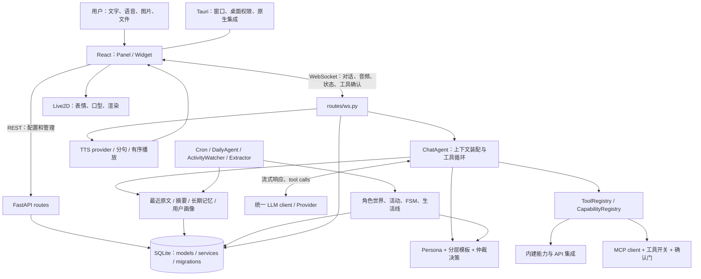
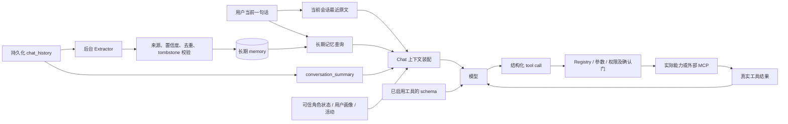

# 项目架构与功能导航图

> 英文常称 **Codebase Map / Architecture Overview**。本文件是 agent 的项目导航入口。
> 核对日期：2026-10-13；依据当前工作区（含未提交改动），不是线上发布清单。
> 基线：`codex/code-slimming-baseline-20261001` / `00a164da`。使用前执行 `git status --short`，不要假设仍停在此快照。

**2026-11-17 全局复核：**当前源码、定向回归与运行时问题见 [INV-29](INV-29-global-architecture-review-2026-11.md)；抽出的能力、保留/重建边界及框架对照见 [ARCH-001](product/ARCH-001-runtime-renewal.md)。下方架构图仍描述现有实现，新框架尚未安装或接入。原功能表的全量状态日期保留，避免把本轮定向核对写成全功能重新验收。

## 1. 新 agent 的三分钟入口

2026-11-21 的[麦麦 v1.4.8 全功能与 Momo 开发取舍](INV-42-maibot-capabilities-and-momo-fit.md)覆盖发行版、官方市场全量索引、自拍与视频、手机镜头以及桌宠端差异。

2026-11-19 的 [MaiBot v1.4.6 源码学习汇总](INV-39-maibot-v1.4.6-overview.md) 以一轮私聊串起消息调度、回复、记忆、日程、插件和桌宠，附正式版与 main 的差异。

当前产品工作先读[新版 PRD v0.95](product/PRD-momo-next.md)。在主机与 Mac 上试用原版，使用[5070 Ti 装机验收与双机协作清单](product/SKYLER-5070TI-ACCEPTANCE.md)。本导航描述旧项目的现有能力，不能据此认定这些能力全部需要进入新版。
2026-11-22 起新版称 Skyler。麦麦可直接复用的功能、DSH 插件与自有客户端各自负责的部分见[二开分工建议](product/ARCH-001-runtime-renewal.md#skyler-基于麦麦二开的分工建议)。
2026-11-22 新增已确认验证方向：[出差前交给 Mac、返程交回主机](product/SPEC-momo-next-details.md#512-主机与-mac-的计划交接2026-11-22-已确认验证方向)。先完成原版跨端基线，再用测试数据验证基础交接；当前尚未实测。
按功能查询时使用[Skyler 复用、二开与测试总表](product/SKYLER-FUNCTION-REUSE.md)，涵盖十个功能域与后续专项。
2026-11-21 的 PRD v0.90 已纳入[上网学习并私下反馈](product/SPEC-momo-next-details.md#58-主动性渐进学习与可控感知一级范围补充)。Momo、麦麦、DSH 及服务账号各自的职责见[架构讨论稿](product/ARCH-001-runtime-renewal.md#模块边界与账号连接)。此前已确定[语音聊天可逐条听原声](product/SPEC-momo-next-details.md#543-n-061-语音输入与前端聊天记录2026-11-18)。本轮收藏的用途与插件本地回放见 [INV-41](INV-41-online-learning-and-bilibili-replies.md)。

办事时[直接复用 DSH 的操作授权](product/SPEC-momo-next-details.md#5102-办事时的操作授权)。邮件回复沿用插件本身的确认设置。

此前已确定[资料引用与文件交付](product/SPEC-momo-next-details.md#59-长期资料操作模式与在线持续工作)及[首轮范围、部署与测试分工](product/HISTORY-momo-prd-v0.94.md#27-二级功能讨论进度)。5070 Ti 主机优先运行后端，Mac、手机等可作客户端。麦麦、DSH 的[新版检查、办事习惯、人工接管与权限](INV-32-skill-mcp-foundations.md#7-新版提醒办事习惯接管与权限)已核对。游戏插件预留[设置入口](product/SPEC-momo-next-details.md#510-统一管理入口与角色-prompt-归属)，前端后定。临时接手和独立队友两种玩法见 [INV-36 游戏调查](INV-36-scene-perception-reuse.md#按游戏核对陪伴与实际操作)与[联机案例 08](../.agents/skills/momo-refactor-cases/references/cases.md#08--她接手挖矿还是作为队友去挖)。

此前 PRD v0.54（2026-11-19）：进入记忆与学习，MaiBot 机制核对见 [INV-38](INV-38-maibot-memory-and-learning.md) / PRD §3.3；自动写入方式仍待定。此前 v0.53：角色制作/驱动已分出[独立测试研究线](research/CHARACTER-LAB-HANDOFF.md)，先测能力再定产品范围，撤回此前提前追加的接口建议。此前 v0.52：补入 ADRY 实时动作及 Tripo + Astra 分部件 3D 制作研究，见 INV-37 §7 / PRD §5.5.4；ADRY 代码和资源口径待查，未选型。此前 v0.51：LumenAct 自然语言表情候选已核对，语义选择与表演曲线可复用，3D/Live2D 适配路线见 INV-37 §6 / PRD §5.5.3；未安装或选型。此前 v0.50：图片到 3D/Live2D 与动作表情预设研究见 [INV-37](INV-37-image-model-rig-and-motion-presets.md) / PRD §5.5.2；绑定完成后可批量预设，当前未锁定工具或 3D 首期范围。此前 v0.49：默认音频设备、暂停 TTS、停止播报归入打断，保留自身回声处理，去掉额外设备/停止/暂停收听控件要求，见 PRD §5.4.10 / 接口 §2。此前 v0.48：说话人区分暂不列一期必做，保留可选接口，资源开销后续实测，见 PRD §5.4.9。此前 v0.47：已在线复核 voice-mode 与 voice-loop，基础语音插件存在，完整覆盖未找到，优先评估接入/二开；见 INV-33 §14 / PRD §5.4.8。此前 v0.46：明确插件满足即采用、部分满足只补差异；语音候选覆盖和验证项见 PRD §0 / §5.4.8，接口与 ARCH 已同步。此前 v0.45：确认直接对话开口让话、后台陪伴判断是否对 Momo 说话，承接插问/停止/新请求/继续，见 PRD §5.4.7 / 接口 §2；自动恢复细节后定。此前 v0.44：TTS 实施前更新调研；新版前端需改善整体臃肿与视觉问题，承接功能但不照搬旧 UI，正式设计后置，见 PRD §5.4.6 / §5.5。此前 v0.43：按旧版思路维护 TTS 库，承接模型/参考素材管理、角色声音选择与试听；旧实现核对见 INV-33 §13。此前 v0.42：声音表达随 TTS 实际能力提供，承接用户自有 GPT-SoVITS 微调模型，不预设句内情绪控制；官方 v5 核对见 INV-33 §12 / PRD §5.4.6。此前 v0.41：确认重要性/紧迫性/当前状态的提醒判断原则，本项先收束；回到 N-06.2 角色声音与语音输出，见 PRD §5.4.6。外源消息筛选与择时提醒，睡眠默认不打扰、特别紧急事件可例外提醒，普通重要内容醒来汇总、垃圾邮件不报，见 PRD §5.8.2 / 接口 §2.5。此前 用户澄清指邮件到达作为事件、重要时提醒，不单设邮件聊天；撤回上轮关于评论的误读，见 PRD §5.8.2 / 接口 §2.5。邮件小项目标已清楚，整体需求仍在定义。当前先盘点现成插件能力，清单见 INV-36 §8，具体选型、接入及二开后定。区分外部信息来源与 MCP/插件/API 接入方式，已有能力直接复用，读取与新消息发现分别核对。外部信息接入及重要消息提醒，见 PRD §5.8.2；最新顺序为先研究现成 DSH 插件，接入看效果后再二开，不预先融合多个项目，见 INV-36 §7。环境/场景感知复用调查见 [INV-36](INV-36-scene-perception-reuse.md) 与 PRD §5.8.1，已核对 DSH/MaiBot 相关源码，未选型或实施。确认游戏/干活等场景免唤醒记录与主动陪伴方向，支持结合场景吐槽或鼓励，具体参与策略后定，见 PRD §5.4.5、§5.8 / INTERFACE-001 §2.4。唤醒按独立插件定义，启停/配置/状态/事件契约见 INTERFACE-001 §2.3；DSH 插件调查及优化建议见 INV-33 §11，具体实现后定。承接旧 Momo 激活后持续收听与自动分段接话，见 PRD §5.4.4 / INTERFACE-001 §2.3；普通话为主夹少量英文，ASR 已确定 faster-whisper 的 medium / large-v3-turbo 两个选项，默认值后定；评估见 INV-33 §9；形态切换与状态呈现参考旧 Momo，当前只留定义和接口、实现后定；继续语音与呈现需求，已确认 Momo 自有交互、ASR 前端聊天记录，以及窗口与仅角色两种形态，见 PRD §5.4.3/§5.5.1 和 INTERFACE-001 §2.1/§2.2；大肥鱼交互参考见 INV-35 续查。v0.23 的需求回滚继续有效，保留十项一级能力与语音/对话草案；自主建设及 DSH 插件加外置项目方向不变，未选社区母项目，当前不写代码。逐项需求与技术同步方式沿用。交接见 [HANDOFF](product/HANDOFF-momo-requirements-2026-11-18.md)。
PRD v0.19 的设置分类见 §5.10.1：能力启停与模式/实现选择分开，允许其他设置类型；接口草案同步，未实现。
当前 PRD v0.18 补入语音开关/模块与前后端交互需求；[INTERFACE-001](product/INTERFACE-001-frontend-backend-contract.md) 为输入、结果、状态与取消的草案入口，未实现；AnifLive-TTS 续查见 INV-33 §8。
2026-11-18 / PRD v0.17：对话与理解留到最后，当前讨论语音二级功能（§5.4.1）；此前草案保留，未启动实施。
最新 PRD v0.15：后端优先，测试前端只承担功能验证，正式前端重建后置（§5.5）；当前未进入实现。
PRD v0.16 从对话与理解开始二级定义，八项子功能草案与待确认行为见 §5.11；本轮核对 MaiBot 最新聊天场景资料，不代表已移植。

PRD v0.11 补入后续多角色同时启用、共同会话与彼此交互目标（§5.7）；首期单角色优先，框架与发布范围未定。此为需求更新，不是现有多角色能力验收。
PRD v0.12 续增主动交流/提醒、渐进学习表达偏好与做事方式、可开关的屏幕/应用/视频感知方向（§5.8）；具体场景与规则待二级定义，未启用采集或学习实现。
PRD v0.13 确认长期个人资料库、任务驱动/持续操作两种模式及在线期间持续工作（§5.9）。最新 v0.14 已整理为十项一级能力，统一管理入口与角色 Prompt 归属见 §5.10；二级定义时更新技术探索，首版范围未定。

2026-11-17 新增 [旧能力迁移取舍与技术更新盘点](INV-33-legacy-capabilities-and-technology-refresh.md)：按当前源码定向核对 22 项能力，供重构取舍使用；未重跑全量功能验收，不改变下表历史状态。

1. 读 [AGENTS.md](../AGENTS.md) 与 [工作协议](PM-CC-PROTOCOL.md)，了解 Git、真数据和验收边界。
2. 在本文“功能定位表”找到对应行，先读入口和核心实现，再看关联测试。
3. 查 [ROADMAP](../ROADMAP.md) 的实施状态；F 系列产品状态以 [FEATURE-INDEX](product/FEATURE-INDEX.md) 和对应 PRD 为准。
4. 查 [最新工程验证与架构复核](INV-29-global-architecture-review-2026-11.md)、[前轮生命周期验证](INV-27-lifecycle-and-regression-gates.md) 与 [调查索引](INVESTIGATION-INDEX.md)，避免重做已回退的实验。
5. 开始改动前，用 `rg -n '函数名或事件名' backend frontend/src tests` 核实调用者；图中的关系是导航，不是运行时追踪证明。

**真源分工：**代码解释当前行为；ROADMAP 记录实施；FEATURE-INDEX 记录产品验收；INV 保存调查证据；[DESIGN_LITE](../DESIGN_LITE.md) 管设计约束。README 含公开版与本地版的区别，不能单独用它判断当前工作区功能。

## 2. 系统总图



主入口：[frontend/main.tsx](../references/SOURCE-REFERENCES.md#source-f687de21d3) → [App.tsx](../references/SOURCE-REFERENCES.md#source-e56cb91573)；[Tauri main.rs](../references/SOURCE-REFERENCES.md#source-135af06ceb)；[backend/main.py](../references/SOURCE-REFERENCES.md#source-df5184bf1f) 的 `lifespan`、路由挂载和启动标记。

## 3. 功能定位表

“有关联测试”只表示可找到验证入口；本轮没有重跑全仓测试，也没有替代真机验收。表中的符号名适合 `rg`，比长期保存行号更耐代码移动。

| 功能 / 常见问题 | UI 或协议入口 | 核心实现与数据 | 验证入口 / 当前边界 |
|---|---|---|---|
| 启动、卡在 warming、退出 | [LoadingScreen](../references/SOURCE-REFERENCES.md#source-51fababb6a)、[useLoadingSequence](../references/SOURCE-REFERENCES.md#source-d8e6548303)、[health_api](../references/SOURCE-REFERENCES.md#source-bdb3b67d30) | [main.lifespan](../references/SOURCE-REFERENCES.md#source-df5184bf1f)、[boot_tracker](../references/SOURCE-REFERENCES.md#source-f31006a652)、[loading engine](../references/SOURCE-REFERENCES.md#source-fc1a030f64) | engine / boot marks / appReady 四路 gate 是真源；后台任务由 [BackgroundTasks](../references/SOURCE-REFERENCES.md#source-37bdde9258) 持有；[异常清理契约](../references/SOURCE-REFERENCES.md#source-7e739f892c) 已通过，整机启动时延待测 |
| 聊天、断线重连、打断、附件 | [useWebSocket](../references/SOURCE-REFERENCES.md#source-9cd0a8941d)、[ChatInput](../references/SOURCE-REFERENCES.md#source-5d00f10db5)、[turnAck](../references/SOURCE-REFERENCES.md#source-7cd1464337) | [ws](../references/SOURCE-REFERENCES.md#source-5220959ddd)：`_handle_message`、`_TurnState`、`_save_interrupted_turn`、`_select_attachments`；[chat](../references/SOURCE-REFERENCES.md#source-6a784c600a)：`ChatAgent.stream` | [WS helpers](../references/SOURCE-REFERENCES.md#source-aac9e3a801)、[附件边界](../references/SOURCE-REFERENCES.md#source-898fe2ce37)、[turn ack](../references/SOURCE-REFERENCES.md#source-186163cd7a)；确认回执与外部工具幂等性是不同问题 |
| 历史会话、切角色后串话 | [ConversationList](../references/SOURCE-REFERENCES.md#source-f894d2e659)、[ChatHistoryPanel](../references/SOURCE-REFERENCES.md#source-56c1718ed1) | [conversations_api](../references/SOURCE-REFERENCES.md#source-215f649c43)、[short_term](../references/SOURCE-REFERENCES.md#source-4ded000c56)、[history_window](../references/SOURCE-REFERENCES.md#source-be7bab9fc7)；`chat_history` / `conversations` | [最近原文契约](../references/SOURCE-REFERENCES.md#source-2c8332d3e7)、[记忆总契约](../references/SOURCE-REFERENCES.md#source-787be596c7)；最近原文按用户、角色、会话分桶 |
| 人设、助手卡 / 社交卡、回答格式 | [PersonaEditorModal](../references/SOURCE-REFERENCES.md#source-d0546243ba)、[persona_api](../references/SOURCE-REFERENCES.md#source-d0ecf2a481) | [renderer](../references/SOURCE-REFERENCES.md#source-cc507e6cb0)：`render_system_prompt`；[persona_loader](../references/SOURCE-REFERENCES.md#source-972fc685d6)、[模板目录](../references/SOURCE-REFERENCES.md#source-07a9fd0985)、[output_adapter](../references/SOURCE-REFERENCES.md#source-dbdf249302) | [平台约束](../references/SOURCE-REFERENCES.md#source-d1d7fce99a)、[画像结构](../references/SOURCE-REFERENCES.md#source-aec2dd9b11)；renderer 与 legacy fallback 仍并存，不能看到 legacy 就删 |
| “上次提到的事”、长期记忆遗漏 | [MemoryManagerDrawer](../references/SOURCE-REFERENCES.md#source-27bef81d3e)、[memory_api](../references/SOURCE-REFERENCES.md#source-408f68837b) | [extractor](../references/SOURCE-REFERENCES.md#source-9abb47cb4b)、[validator](../references/SOURCE-REFERENCES.md#source-3389389ff0)、[long_term](../references/SOURCE-REFERENCES.md#source-521d60a11a)、[summary](../references/SOURCE-REFERENCES.md#source-73bb6514a6)、[tombstone](../references/SOURCE-REFERENCES.md#source-5dce6bd109) | [抽取 E2E](../references/SOURCE-REFERENCES.md#source-4180b9916f)、[验证器](../references/SOURCE-REFERENCES.md#source-051667022d)、[INV-24](INV-24-memory-and-tool-routing.md)；批次编码已复用（[对照测试](../references/SOURCE-REFERENCES.md#source-ed1f2e4b22)）；短句跳过、失败批次游标与来源粒度待评估 |
| 用户画像 | [UserProfileSection](../references/SOURCE-REFERENCES.md#source-2da9027296)、[profileData client](../references/SOURCE-REFERENCES.md#source-b4faef18e3) | [users_api](../references/SOURCE-REFERENCES.md#source-e9bcb1c142)、[profile_regen](../references/SOURCE-REFERENCES.md#source-93eed532f9)、[profile_schema](../references/SOURCE-REFERENCES.md#source-c468b0a0c2)；结构化 `profile_data` | [profile_data API](../references/SOURCE-REFERENCES.md#source-bdeda3a515)、[profile user only](../references/SOURCE-REFERENCES.md#source-d677c71b04)；已删除旧前端 `profile.ts`，不等于所有 DB 兼容字段退役 |
| 工具找不到、选错、执行失败 | [CapabilityPanel](../references/SOURCE-REFERENCES.md#source-7c94b5facd)、[ExtensionsSection](../references/SOURCE-REFERENCES.md#source-2a5166e39f)、[MCPConfirmModal](../references/SOURCE-REFERENCES.md#source-d0953bff08) | [ToolRegistry](../references/SOURCE-REFERENCES.md#source-4baeff10b9)、[CapabilityRegistry](../references/SOURCE-REFERENCES.md#source-3a15c19267)、[mcp/client](../references/SOURCE-REFERENCES.md#source-9aa1d0cadd)、[tool_state](../references/SOURCE-REFERENCES.md#source-9f52d9c090)、[confirm_gate](../references/SOURCE-REFERENCES.md#source-d65b19e4ee) | [MCP 并发启动](../references/SOURCE-REFERENCES.md#source-e49b18fffd)、[工具过滤](../references/SOURCE-REFERENCES.md#source-84c29d98e9)、[工具状态](../references/SOURCE-REFERENCES.md#source-b5a76f06f6)；`_get_all_tools` 仍传入当前完整 schema，动态工具检索尚未实现 |
| 工具返回后胡说、输出工具标签 | [ChatAgent](../references/SOURCE-REFERENCES.md#source-6a784c600a) | `_execute_tool`、`truncate_tool_result`；[tool_call_resilience](../references/SOURCE-REFERENCES.md#source-9f2abbca4e)、[tool_addendum](../references/SOURCE-REFERENCES.md#source-af2a0bf3f8)、[LLM client](../references/SOURCE-REFERENCES.md#source-aa520db9ae) | [工具截断](../references/SOURCE-REFERENCES.md#source-f10f54780b)、[标签兜底](../references/SOURCE-REFERENCES.md#source-45cc78028e)；必须核对真实返回，prompt 不能代替权限校验与执行状态 |
| 麦克风、VAD、ASR、语音打断 | [useAudio](../references/SOURCE-REFERENCES.md#source-1d1428b12c)、[micStream](../references/SOURCE-REFERENCES.md#source-257a49c188) | [whisper](../references/SOURCE-REFERENCES.md#source-0bb602bd68)、[ws TTS 队列](../references/SOURCE-REFERENCES.md#source-5220959ddd)、[TTS registry](../references/SOURCE-REFERENCES.md#source-17ce0edace)、[ttsAudio](../references/SOURCE-REFERENCES.md#source-109389bca5) | [麦克风所有权](../references/SOURCE-REFERENCES.md#source-7754224099)、[播放生命周期](../references/SOURCE-REFERENCES.md#source-003f8c8b2d)；真机权限、耳听衔接与打断待验收 |
| Live2D、口型、立绘、桌宠 | [Live2DCanvas](../references/SOURCE-REFERENCES.md#source-671b0a23eb)、[Widget](../references/SOURCE-REFERENCES.md#source-f8a57752c4)、[CharacterGallery](../references/SOURCE-REFERENCES.md#source-038f12c77d) | [runtime](../references/SOURCE-REFERENCES.md#source-e414a7fb5d)、[pixiCubism4](../references/SOURCE-REFERENCES.md#source-b2313a1a08)、[useAudioAmplitude](../references/SOURCE-REFERENCES.md#source-16079e6bb5)、[live2d_api](../references/SOURCE-REFERENCES.md#source-dcfa1092d5) | [模型上传](../references/SOURCE-REFERENCES.md#source-d6bde5d6fe)；口型采样已按播放活动启停，帧率与整机内存收益尚无测量 |
| 活动感知、读屏、剪贴板 | [ActivityAwarenessSection](../references/SOURCE-REFERENCES.md#source-9542fe6a52)、[ActivityTimelineDrawer](../references/SOURCE-REFERENCES.md#source-2aa4a9dfe9) | [activity_watcher](../references/SOURCE-REFERENCES.md#source-4d7b270477)、[activity_timeline](../references/SOURCE-REFERENCES.md#source-cd3e315ebb)、[screen capability](../references/SOURCE-REFERENCES.md#source-41ed4e9edc)、[clipboard](../references/SOURCE-REFERENCES.md#source-ad254d3ef1) | [活动观察](../references/SOURCE-REFERENCES.md#source-8d8fa1e7a9)、[屏幕能力](../references/SOURCE-REFERENCES.md#source-7d8f890550)；应用活动记录、按需读屏与 MCP 写工具是不同能力 |
| 日历、提醒、早报、主动说话 | [briefing_api](../references/SOURCE-REFERENCES.md#source-e9e0735247)、[capabilities/calendar](../references/SOURCE-REFERENCES.md#source-726c1fc857) | [cron](../references/SOURCE-REFERENCES.md#source-6fa6787fdc)、[briefing](../references/SOURCE-REFERENCES.md#source-8bc8132372)、[proactive engine](../references/SOURCE-REFERENCES.md#source-d387440a18)、[triggers](../references/SOURCE-REFERENCES.md#source-8cb60f7503)、[apple_calendar](../references/SOURCE-REFERENCES.md#source-ba32f42b3c) | [wake briefing](../references/SOURCE-REFERENCES.md#source-e42150bbb0)、[Apple Calendar](../references/SOURCE-REFERENCES.md#source-2223059138)；旧 `AlarmScheduler` 已退役，关机/休眠下交付需真机验证 |
| 模型、API Provider、TTS 配置 | [AIProvidersSection](../references/SOURCE-REFERENCES.md#source-fa133476b2)、[SettingsPanelV2](../references/SOURCE-REFERENCES.md#source-faa2165cfd) | [ai_providers_api](../references/SOURCE-REFERENCES.md#source-65c004b576)、[ai_providers DB](../references/SOURCE-REFERENCES.md#source-1f2f472f9e)、[provider_options](../references/SOURCE-REFERENCES.md#source-8ced7a8469)、[voice_config](../references/SOURCE-REFERENCES.md#source-7483c91cf6) | [provider backend](../references/SOURCE-REFERENCES.md#source-8193a6c056)、[provider 保留自定义项](../references/SOURCE-REFERENCES.md#source-5324c3e4bb)；模型名、密钥与本机配置不写入图谱 |
| 音乐、媒体、外部内容 | [capabilities](../references/SOURCE-REFERENCES.md#source-748c41891a)、[integrations](../references/SOURCE-REFERENCES.md#source-62686f4901) | `netease_music` / `netease_playback` → `mpv_player`；`bilibili`、`xiaohongshu`、`docx_ops` 各自适配器 | [网易能力](../references/SOURCE-REFERENCES.md#source-5e37eb4575)、[mpv](../references/SOURCE-REFERENCES.md#source-982d0e89cb)、[Bilibili](../references/SOURCE-REFERENCES.md#source-a224d0621e)；真实外部服务结果需单独验证，勿把脚本测试默认当离线 |
| CPU、RAM、Token 与费用 | [SystemPanel](../references/SOURCE-REFERENCES.md#source-fbc5606711)、[observability_api](../references/SOURCE-REFERENCES.md#source-0bb9667571) | [system.collect](../references/SOURCE-REFERENCES.md#source-e596941acb)、[token probe](../references/SOURCE-REFERENCES.md#source-07475b223f)、[tts_log](../references/SOURCE-REFERENCES.md#source-f5bfcbe8bc)、[tts_aggregate](../references/SOURCE-REFERENCES.md#source-235adec757) | [CPU 采样契约](../references/SOURCE-REFERENCES.md#source-04fe509c46)；本轮已修采样基准丢失。backend RSS 不能代表 Tauri/WebView/MCP/模型子进程的总内存 |
| 数据结构、升级、启动迁移 | [database/models](../references/SOURCE-REFERENCES.md#source-8fa12f08c7)、[database/services](../references/SOURCE-REFERENCES.md#source-5d1caa4108) | [run_all_migrations](../references/SOURCE-REFERENCES.md#source-8a5be5df7b)、[迁移目录](../references/SOURCE-REFERENCES.md#source-a8b339056b)、[数据库会话](../references/SOURCE-REFERENCES.md#source-2ebd20b913) | 迁移顺序有依赖，当前逐项幂等迁移不能按“文件多”批量删；验证应使用临时或克隆数据库 |

## 4. F 系列：代码在哪里，做到哪一步

下表状态抄录自功能台账，核对于 2026-10-13；后续以台账更新为准，不在这里维护测试通过数量。

| ID | 核心文件 | 关联测试 | 当前状态 |
|---|---|---|---|
| F-001 时间一致性 | [temporal_context](../references/SOURCE-REFERENCES.md#source-e035356118)、[chat_time](../references/SOURCE-REFERENCES.md#source-799661e4ce) | [temporal prompt](../references/SOURCE-REFERENCES.md#source-f2f4577349) | 待验收 |
| F-002 世界锚点与日常运行时 | [character_world](../references/SOURCE-REFERENCES.md#source-3efd9e5e2c)、[daily_plan](../references/SOURCE-REFERENCES.md#source-ba51ee23ae)、[daily_runtime](../references/SOURCE-REFERENCES.md#source-e3a9aa0b66)、[daily_ticker](../references/SOURCE-REFERENCES.md#source-72d43fcc5d) | [Stage2A](../references/SOURCE-REFERENCES.md#source-0f1ad4587c) | 待验收；社交卡 |
| F-003 持续生活线 | [life_threads](../references/SOURCE-REFERENCES.md#source-dd5896f09f)、[life_thread_settlement](../references/SOURCE-REFERENCES.md#source-f9feb8a98b) | [生活链集成](../references/SOURCE-REFERENCES.md#source-2e0306d47a) | 待验收；社交卡 |
| F-004 分享储备 | [sharing_reserve service](../references/SOURCE-REFERENCES.md#source-6b0d9767df)、[主动分享触发](../references/SOURCE-REFERENCES.md#source-232193b62a) | [sharing reserve](../references/SOURCE-REFERENCES.md#source-c39ae7c8ca) | 待验收；社交卡 |
| F-005 偏好成长 | [preference_evolution](../references/SOURCE-REFERENCES.md#source-e4388d4efd) | [preference evolution](../references/SOURCE-REFERENCES.md#source-37b6573d27) | 待验收；社交卡 |
| F-006 状态机 | [character_fsm](../references/SOURCE-REFERENCES.md#source-8ca16d2069)、[fsm_activity_timeline](../references/SOURCE-REFERENCES.md#source-8b03ca90ca) | [FSM v1](../references/SOURCE-REFERENCES.md#source-4cebaa26ce) | 待验收；社交卡 |
| F-007 上下文仲裁 | [context_arbitration](../references/SOURCE-REFERENCES.md#source-8ec172e8c4)、[chat 接入](../references/SOURCE-REFERENCES.md#source-6a784c600a)：`_build_f007_decision_card` | [arbitration](../references/SOURCE-REFERENCES.md#source-d35ced6026)、[prompt integration](../references/SOURCE-REFERENCES.md#source-53ef7c768a) | 部分完成；明确 `claim_key` 的仲裁不等于自由语义冲突识别 |
| F-008 ComfyUI | [ComfyUIConnector](../references/SOURCE-REFERENCES.md#source-8c982d6e6f) | [ComfyUI integration](../references/SOURCE-REFERENCES.md#source-458d2f3dba) | 独立连接器待验收，尚未暴露给角色工具调用 |

## 5. “记住一件事”和“调用一个工具”走哪条链



- **ChatAgent 当前默认召回以用户为共享范围**；底层检索支持可选角色过滤，但两个聊天调用未传 `character_id`。角色 ID 的来源标注不能解释为默认查询隔离。最近原文与摘要有角色/会话边界。查询短句长度门槛、失败批次处理详见 [INV-24](INV-24-memory-and-tool-routing.md)。
- **Prompt 的职责**是提供简短行为规则、当前相关证据和工具选择指引。它不承担数据存储、到点调度、权限控制或幂等执行。
- **未来建议**是按意图检索相关记忆/文档、按需提供工具 schema，并在低置信度时补充检索；这些路由尚未整体实现。设计候选见 [INV-25](INV-25-commercial-assistant-research.md)；2026-10-23 的中文检索实验、逐条来源和四方向修改大纲见 [INV-28](INV-28-assistant-upgrade-research-outline.md)，属于候选方案，未更新为功能完成状态。
- 记忆与工具返回属于证据，不能提升成系统指令；用户临时说法、持久事实、任务状态、角色设定应保留各自的数据来源。

## 6. 验证入口与不能推导的结论

以下命令从仓库根目录执行；这是按功能挑选检查的入口，不是一个已经通过的全仓门禁。

```sh
# 已审查的定向检查：每个文件独立进程与临时数据库；不是全仓测试
.venv/bin/python scripts/run_slimming_checks.py --list
.venv/bin/python scripts/run_slimming_checks.py

# 前端静态验证；有前端改动时运行
(cd frontend && npx tsc --noEmit)
(cd frontend && npm run build)

# 音频资源生命周期；不是麦克风与耳听验收
node --experimental-strip-types --test frontend/src/lib/micStream.test.mjs frontend/src/lib/ttsAudio.test.mjs

# 查找具体调用者/测试，不依赖本图的历史行号
rg -n 'lifespan|_get_all_tools|_extract_batch|_sample_process' backend tests
```

运行其他 Python 测试前先看其文件头和初始化：仓库混有 pytest、`asyncio.run(main())` 独立脚本、真实外部服务测试，以及导入阶段替换 DB/环境的老脚本。不要直接把 `pytest tests` 当作隔离完备的验收入口。5 份旧测试原稿已移到 [legacy_source](../references/SOURCE-REFERENCES.md#source-55eddb797b)，当前 WS/工具断言已迁移；定向入口的范围与 16 文件通过结果见 [INV-27](INV-27-lifecycle-and-regression-gates.md)。

2026-11-17 原 16 文件重验通过；新增 [Token 观测测试](../references/SOURCE-REFERENCES.md#source-b565689fa3) 后入口包含 17 文件，受影响 chat 分组 6/6 通过。Token 日志使用 schema_version=2 和唯一 call_id 配对，完整请求估数与响应 usage 分开；固定 estimator_model 尚未改成实际 dispatcher 模型。F-006 契约不一致已修正，真实角色表现仍待验收。

全应用 `lifespan` 会启动 Cron、抽取器、活动观察和 DailyAgent catch-up；它是有副作用的启动流程。集成测试应显式隔离数据库与外部能力。自动检查通过不能证明真实对话质量、声音衔接、桌面权限、关机提醒或视觉效果已验收。

## 7. 已做优化、剩余问题与不要重复的实验

- 已做范围：[REF-001 实施记录](product/REF-001-code-slimming.md)、[全项目范围说明](INV-23-project-slimming-scope.md)。包括前端按需加载、音频释放、口型空闲采样、MCP 并发准备、共享回复清洗等；不等于全项目所有优化完成。
- [INV-26 复查](INV-26-project-map-and-optimization-review.md) 的生命周期/测试问题已在 [INV-27](INV-27-lifecycle-and-regression-gates.md) 定向处理；DailyAgent 无调用辅助链已删除。启动历史恢复规模、全进程资源与记忆/工具行为仍需独立测量或质量评估。
- **已回退实验：**renderer 的 profile/activity/memory 并发读取在两轮真实 DB 对照中收益不稳定，已恢复串行。不要凭合成 sleep 提速再次宣称产品提速。
- **两轮止损：**同一问题修改后连续两轮仍存在，回退该问题的改动、记录原因并跳过；保留其他已验证成果。

## 8. 如何维护，避免图谱再次过期

本文件是精简的功能导航；[机器图谱](../references/SOURCE-REFERENCES.md#source-a6ccf49c4c) 用于查文件/符号/依赖，[元数据](../references/SOURCE-REFERENCES.md#source-f9452f1836) 用于检查其生成时间。**当前机器图谱已标记 stale**：本轮函数/测试移动发生在其生成之后。先读本导航与源码；meta 的变更清单供下次增量刷新。生成图谱不是产品验收证据。

每次新增、删除、移动功能入口，或状态进入验收/回退时，在同一个改动批次中：

1. 更新本文对应功能行、数据边界和核对日期；有架构关系变化才改图。
2. 在 ROADMAP 更新实施状态，在 FEATURE-INDEX/PRD 更新产品状态；调查过程进入新的或对应 INV。
3. 核对链接存在，运行相关功能测试，并记录**本轮实际执行**的命令和结果。
4. 重新生成图谱时，把未提交及未跟踪源码纳入变更；排除密钥、本机配置、聊天数据、二进制资产、依赖、个人输出和图谱自身。
5. 图谱增量合并同时移除已删节点与悬空关系。若只记录 HEAD 而工作区有改动，必须标注 working tree 快照，不能声称与提交完全一致。

给下一位 agent 的交接至少包含：任务目标 → 功能行/符号 → 改动 → 运行过的检查 → 尚未验收 → 已回退尝试。无需把全仓文档硬编码到每轮 prompt。
