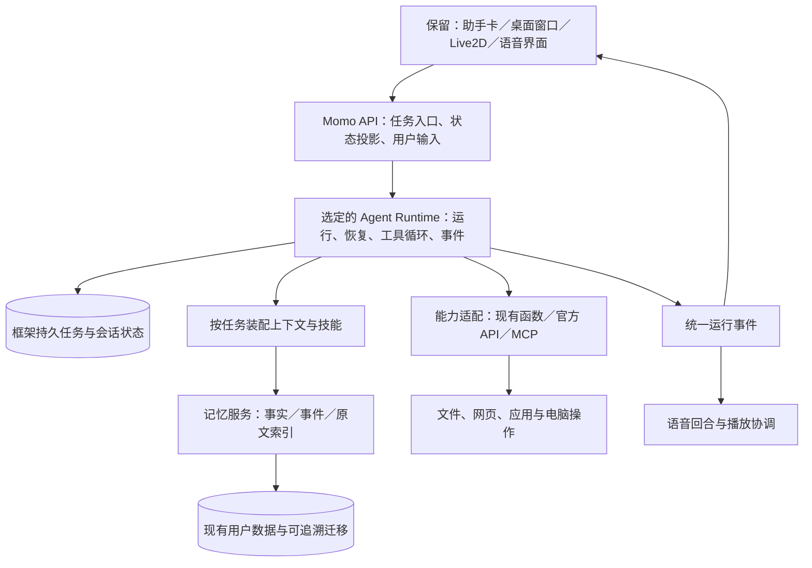

# ARCH-001 · 能力抽取与 Agent 运行时重建评估

**2026-11-22 接手澄清。** 当前采用方向为基于麦麦二开、按需委托 DSH；Skyler 是新版产品名。下文 11 月 21 日的三方表是职责讨论，不要求另建一套 Momo 主后端。更早的 DSH 底座、拆取麦麦组件、自建执行核心等保留为历史评估；当前先验原版，按实际缺口设计改动。完整需求状态见 [PRD §2.7](HISTORY-momo-prd-v0.94.md#27-二级功能讨论进度)。

## Skyler 基于麦麦二开的分工建议

当前从[5070 Ti 原版验收与 Mac 联合开发](SKYLER-5070TI-ACCEPTANCE.md)开始。逐项分工见[十个功能域总表](SKYLER-FUNCTION-REUSE.md)。11 月 22 日对“必须二开”的复核找到了现成的音色管理、审批、文件分享、邮件晨报及来源监控，下表按实际端点差异更新。是否改代码取决于所选路径。[已核实的差异与条件](SKYLER-FUNCTION-REUSE.md#哪些情况实际需要改代码)

2026-11-22。新版产品名定为 **Skyler**。建议在 5070 Ti 主机上以 MaiBot 运行主人私聊、人格、记忆、历史和日程。每项功能优先采用麦麦已有实现；选中的 DSH 插件继续在 DSH 运行，麦麦通过现有桥委托任务。Skyler 的差异尽量放在麦麦插件或客户端中。具体是否要改麦麦核心，取决于相应扩展接口能否覆盖已确认需求。[麦麦 v1.4.8 能力调查](../INV-42-maibot-capabilities-and-momo-fit.md) · [DSH 桥接插件](https://github.com/SengokuCola/dsh-maibot-bridge)

| Skyler 要负责的体验 | 已有起点 | 需要接通或实测后补齐的部分 |
| --- | --- | --- |
| 换设备仍能接着聊 | 麦麦原版网页与桌宠已用同一主人会话，桌宠已有聊天面板。旧 Momo 有窗口、仅角色形态和 Live2D | 先沿用原版。额外选择社区 Live2D 桌宠时，核对它独立的 `deskpet-user` 身份。自有界面留待正式设计。 |
| 用声音、镜头连续聊天 | 麦麦有语音转写与原声播放，麦麦社区有 GPT-SoVITS 权重配置和试听。Tobs 已有手机通话 | Tobs v1.7.0 将当句转写和关键帧送入自己的 Bot 私聊，并释放麦克风原声。若选这条通话路径，须对齐麦麦主人会话，并在能取得原声处关联直接发言。指定 ASR、自训音色、唤醒、插话及防回声先用目标设备试。 |
| 从聊天委托到拿到结果 | 麦麦与 DSH 有双向图文传话、聊天附件和局域网文件分享，DSH 有桌面及手机审批 | 文件先以现有附件或可达链接回原聊天。审批先核验路由。若所选桌面桥将确认转给麦麦 v1.4.8 的 ACP 回调，它会自动选择允许一次，须改该路径或改用能等待用户的已有入口。 |
| 按用户的情况提醒或反馈 | 邮件分级、定时晨报、静音队列、来源监控、条件跟进和回报均有 DSH 插件 | 先配置并联测跨来源判断、实际醒来后回麦麦、最终报价只报一次、同意后才替换资料及学习反馈。其中任一项只有复现了具体差异才进入二开。 |

**多人语音保留为单独的 ASR 测试项目。** 首轮语音可独立运行，未能判定说话人的发言保留未标记。后续用同一段双人录音比较现成插件和轻量方案，检查每句话能否正确归到 A 或 B，并测相对基础 ASR 增加的内存、显存和延迟。根据结果决定是否接入可开关的插件。识别已登记的人、两人同时开口时分别转写，各自单独评估。[说话人区分的阶段安排](SPEC-momo-next-details.md#549-n-065-说话人区分的阶段安排2026-11-18)

服务账号的登录和插件安装沿用各自宿主。Skyler 设置里可汇总账号状态、能力开关和游戏插件入口，形式留待前端设计时决定。以上为二开边界建议，两端源码和插件覆盖及实际验证范围见[委托、权限与多端媒体调查](../INV-42-maibot-capabilities-and-momo-fit.md#2-麦麦收到任务以后怎么做)。

## 模块边界与账号连接

**2026-11-22 部署补充：计划交接已获用户认可，先验证主机 → Mac → 主机。** 正常由 5070 Ti 主机承担服务端，出差前主动交给 Mac，返程将新数据交回；每次由一个运行端处理该角色的消息与提醒。先复用上游导出/恢复与换机机制，以测试数据验证；DSH 的存储、账号连接、绝对路径、模型位置和运行中任务分别核对。尚未选同步协议、自动切换或界面，不要求两端同时写入。产品目标见 [PRD §5.12](SPEC-momo-next-details.md#512-主机与-mac-的计划交接2026-11-22-已确认验证方向)，上游起点见[备份与迁移](https://docs.maibot.chat/faq/backup-and-migration)。

2026-11-21 讨论稿。上网学习并在原私聊反馈已纳入功能范围。下表是结合已定复用方向提出的分工，麦麦和 DSH 的接入边界仍需联测。

| 负责方 | 建议职责 |
| --- | --- |
| Momo | 管用户、角色、设备与会话的对应关系。Mac 和手机把输入交给主机，回复回到发起会话，麦克风、摄像头和播放使用相应设备。旧 Momo 已有的窗口与角色切换、语音打断机制按需沿用。 |
| 麦麦 | 整体沿用私聊接话、角色表达、完整人格与记忆 Prompt，以及近期上下文、长期记忆的写入、按需召回和纠错。需要办事时把操作交给工具，取得结果后由同一角色向用户表达。[私聊轮次](https://github.com/Mai-with-u/MaiBot/blob/v1.4.8/src/maisaka/turn_trigger/README.md) · [人格与记忆复用范围](../INV-40-maibot-memory-and-personality.md) |
| DSH 和功能插件 | DSH 承接工具注册、后台任务、执行权限与单次确认。学习、邮箱、游戏等能力按需接入。已有 MCP 直接登记，需要订阅事件或使用设备时再接对应的插件或客户端能力。[DSH 的 MCP 接入](https://github.com/deepseek-ai/deepseek-harness/blob/dsh-v0.2.2-rc.5/packages/mcp/mcp-client/README.md#summary) · [执行确认](https://github.com/deepseek-ai/deepseek-harness/blob/dsh-v0.2.2-rc.5/packages/interaction/user-approval/README.md#summary) |

**用学习插件检验分工。** 用户从手机私聊说“看看学习仓库这次更新对 Momo 有什么用”。Momo 记录发起会话，麦麦理解委托，学习插件经 DSH 读取新资料，交回发现、来源或失败原因。后台插件可以用模型读资料，对用户可见的角色回复统一由麦麦生成。任务稍后完成也回到这次私聊。学习笔记保留在知识仓库，用户的偏好和共同经历归麦麦记忆。以后把来源换成邮件，只需接入对应的读取工具，原来的回报方式仍可复用。

能被调用的操作作为工具接入，主动到达的消息作为事件接入。两者都能关联相应会话，执行结果回到该会话。首轮按职责组织模块，共用一台后端主机。需要客户端硬件、GPU 模型或独立生命周期的部分，再单独部署。麦麦落在哪个进程、怎样把一次工具调用转给 DSH，可用上述场景验证后决定。

**账号建议。** 个人自用阶段，Mac 和手机关联同一个 Momo 用户。在设置里提供一个“已连接账号”入口，按服务显示当前账号、连接状态及可用操作。重连或断开复用各插件提供的入口。读取公开仓库可直接开始。读取私人收藏、邮箱或以指定账号执行操作时，才选用相应的平台连接。对同一服务有个人号和角色号时，按需要选定用途。页面和交互后续再定。

麦麦已有适配器上报的机器人平台身份，可列出、停用和恢复，在聊天平台识别角色自己的账号。DSH 的凭据服务能按插件保存授权记录、报告配置状态，授权服务能把登录或验证码请求送回发起界面。适配 DSH 的服务优先沿用这两项。自带登录流程的插件继续持有自己的凭据，Momo 汇总账号标识、状态和管理入口。账号可用后，具体操作仍遵循已定的 DSH 权限规则。[麦麦平台身份](https://github.com/Mai-with-u/MaiBot/blob/v1.4.8/src/services/bot_account_service.py#L23-L55) · [账号管理操作](https://github.com/Mai-with-u/MaiBot/blob/v1.4.8/src/webui/routers/bot_accounts.py#L70-L98) · [DSH 凭据记录](https://github.com/deepseek-ai/deepseek-harness/blob/dsh-v0.2.2-rc.5/packages/credentials/credentials/README.md#summary) · [DSH 授权流程](https://github.com/deepseek-ai/deepseek-harness/blob/dsh-v0.2.2-rc.5/packages/credentials/authorization/README.md#summary) · [PRD 操作授权](SPEC-momo-next-details.md#5102-办事时的操作授权)

## 此前的部署与实施约定

以下带日期的“当前”“最新”均指当时；与文首方向冲突的建设顺序和底座方案不再作为现行实施指令。

**2026-11-20 部署方向。** 优先让用户的 RTX 5070 Ti 主机运行 Momo 后端，Mac、手机及其他客户端按使用场景接入。用户从手机发起摄像头陪伴，就用手机镜头、麦克风和播放设备。游戏在另一台设备运行时，游戏状态和动作从游戏所在设备取得和执行。具体主机系统、连接方式和模型部署待验证。[首轮范围与分工](HISTORY-momo-prd-v0.94.md#27-二级功能讨论进度)

**2026-11-18 复用规则补充：**该规则同样适用于语音回合、停顿及打断。现成插件经配置和接入可满足需求时直接采用，部分满足则只补实际缺口，不从需求细化推导为全部自研。需求旁记录候选、覆盖、差异和验证状态，见 PRD §0 / §5.4.8。

**2026-11-18 最新实现推进约定：**用户要求先研究现成 DSH 插件，后续接入看效果，再针对实际缺口二开；不预先从多个社区项目抽取融合。用户随后澄清：信息来源不等于插件渠道，已有 MCP 或服务接口可直接接入；“插件优先研究”不要求给邮件等已有能力再套一层插件。既有调研作为候选证据保留，不直接转为组合实施方案。多渠道消息和场景感知候选见 INV-36 §7；当前继续需求与接口文档阶段。

**2026-11-18 当前技术方向与需求回滚：**用户先确认以 DSH 为底座，随后提出“自己操刀，做成 DSH 的插件和外置项目”；现要求回滚受几个社区项目过度影响的功能需求。当前继续自主设计 Momo，DSH 作为接入方向保留；插件、外置模块及宿主的具体职责待验证，未选任何养鱼项目作为母项目。产品范围以 [PRD v0.23](PRD-momo-next.md) 的十项一级能力和用户逐项确认的需求为准，不再按 DSH 四类矩阵组织 PRD。回滚前版本见 [历史快照](HISTORY-momo-prd-v0.22.md)。当前未安装 DSH、迁移或写实现代码。社区研究的范围纠正见 [INV-35](../INV-35-fish-ecosystem-popularity-audit.md)。

**待定接入细节：**已核对的DSH SDK可驱动会话与事件，但无逐会话取消方法；Host Session Controller与社区桥已有取消路径。后续核对所选发行版本，再验证自有桥/Host控制或SDK补充控制接口，不能把关闭共享运行时当语音打断。ASR/TTS可作为独立服务，Momo控制回合、播放与取消。现成插件可能依赖DSH Web服务；具体运行组合、传输协议和旧FastAPI保留范围待定。

**2026-11-18 需求与技术协同方式：**逐个二级功能同步确定需求、组件、接口及验证；最后整合模块、数据和实施批次。见 [PRD §1](HISTORY-momo-prd-v0.94.md#1-定义顺序)。具体接入组合待定，当前仍不开始实现。

**最新实施顺序：**后端能力优先，配套简陋测试前端验证，正式前端重新设计与重建后置，见 [PRD §5.5](SPEC-momo-next-details.md#55-n-07-立绘馆live2d-与前端重设计)。先定义二级需求与实施范围，未开始写代码。测试入口连接真实接口/事件，必要的语音或感知客户端功能随验证提供；当前不锁定正式 UI 框架或布局。

**最新角色扩展要求：**首期单角色优先，后续支持多个角色同时启用、共同会话及互相回应，见 [PRD §5.7](SPEC-momo-next-details.md#57-n-073-后续多角色共同会话与交互)。后续围绕DSH检查角色状态、消息协调和记忆归属。并行任务分工、关系演变及自主社交未确认为功能。

**当前建设主线补充：**需求驱动重构、DSH底座、沿用现有PRD；具体迁移范围后定。此前精简工作的已完成成果与待验收状态保留，未批准删除旧实现。

**新增能力与界面决定：**立绘馆和 Live2D 保留；前端页面重新设计，具体方案共同沟通。因此下文“保留旧 UI”的历史建议不再作为默认方案。全/半双工、说话人区分、图片生成角色模型及 GPT-SoVITS v5 进入需求/技术评估，详见 [PRD §5.4–§5.6](PRD-momo-next.md) 与 [INV-33](../INV-33-legacy-capabilities-and-technology-refresh.md)。不把新版本存在直接视为旧能力应淘汰的证据。

---

以下保留2026-11-17起的历史研究；“尚未选框架”“两路线对照”等表述描述当时阶段，以文首当前方向及需求回滚说明为准。

**2026-11-17 当时范围决定：**Momo保持独立智能体，先复用DSH/WorkBuddy的Skills/MCP、不委派另一成品主智能体。后续已扩展并确认DSH作为Momo自身底座；Codex Skills不纳入的范围不变。

日期：2026-11-17。状态：**架构评估与推荐，尚未选择或安装新执行框架**。用户最新问题是“继续在项目上改，还是抽出需求按新框架重搭”。本文件承接该决策；调查、版本和本轮修正证据见 [INV-29](../INV-29-global-architecture-review-2026-11.md)。

**同日最新方向覆盖：**用户进一步要求从上到下定义新版：功能 → 功能需求 → 技术路线与详细要求 → Astra 实现。当前主入口为 [Momo 重构 PRD](PRD-momo-next.md)，由用户描述需求、PM 整理补缺。下文“保留旧产品层”“优先对照某框架”是上一阶段基于复用成本的建议，不作为新版的强制选型；旧 UI、运行时和组件是否复用均在需求明确后决定。

## 0. 当前补充：FastAPI、WebSocket 与 Agent Harness 的关系

2026-11-17 核对。以下为本轮解释与建议，尚未成为技术选型决定；下文旧方案继续按文首范围覆盖说明理解。

- **现有主流程已有 Agent loop。** `backend/routes/ws.py:967` 和 `:1147` 直接进入 `ChatAgent.stream`，旧 Planner → Tool → Chat 不再是该入口的主链路。`backend/agents/chat.py:2053` 定义模型调用、工具执行、结果回填后继续调用的循环，`:2138` 将模型调用轮次限制为 5。使用一个 LLM 并不妨碍它成为 Agent。
- **FastAPI / WebSocket 与 Harness 属于不同层。** FastAPI 提供服务接口，WebSocket 承载双向消息；Agent loop 决定下一步；Harness 指让循环可持续、可控制、可观察地运行的外围机制，常包括上下文、工具执行、状态、权限、取消与预算。该术语没有要求统一模块清单或多智能体架构。可在 FastAPI 服务中运行这些机制，无需二选一。
- **建议保留 FastAPI / WebSocket 为可用候选，不因年龄替换。** 当前 `requirements.txt:1–6` 对 fastapi、uvicorn、websockets、litellm 未声明版本约束，本轮未核实实际安装版本。框架替换与依赖版本治理分开评估；实施时记录可复现版本和兼容检查。语音全双工还需音频采集、回声处理、回合判断及播放取消，WebSocket 本身的双向传输不能证明产品已具备这些能力。
- **Momo 需要与已选需求对应的运行支撑，建议以单主 Agent loop 为中心。** 优先明确按需记忆/Skill 装配、MCP 结果、运行状态、取消和 Token/时间预算；长任务恢复按入选任务定义。已有工具注册、记忆、日志和中断等资产逐项复核复用。无需把所有部件做成独立进程，也不因 Harness 名称额外增加规划/评审模型调用。确定性调度/workflow 可以与 Agent loop 共存。
- **选型验证对象：**一条使用 Skill/MCP 的多步任务，验证按需加载、读取工具结果、真实完成反馈、取消和预算停止；若入选场景要求断线继续，再验证断线后的执行与状态读取。不能只凭循环存在就认定这些都已具备。

来源：[FastAPI WebSockets](https://fastapi.tiangolo.com/advanced/websockets/)、[Anthropic 的 workflow / agent 区分](https://www.anthropic.com/research/building-effective-agents)、[长任务 Harness 的上下文和环境机制](https://www.anthropic.com/research/effective-harnesses-for-long-running-agents)、[2026-03 Harness 案例](https://www.anthropic.com/research/harness-design-long-running-apps)。后者是编码任务实验，不能直接作为 Momo 采用多智能体的依据。

### 0.1 当前项目与新框架的关系

2026-11-17 续查：当前 `requirements.txt` 和 `backend/` 未发现 LangChain / LangGraph 依赖或调用。`backend/llm/client.py:16` 导入 LiteLLM `acompletion`，由自有 ChatAgent 管理循环。此前文档中的 Deep Agents / LangGraph 为调研候选，不是已安装或已迁移的实现；本次未穷尽全部 Git 历史。

当前官方定位：[LangChain](https://docs.langchain.com/oss/python/langchain/overview) 提供可配置 `create_agent` 与 middleware；[LangGraph](https://docs.langchain.com/oss/python/langgraph/overview) 提供有状态执行、持久化、流式和人工介入；[Deep Agents](https://docs.langchain.com/oss/python/deepagents/overview) 在其上组合规划、文件上下文、Skills 和子智能体等机制。这三者属于同一生态的不同层，不是必须互相替换的三代产品。其他候选包括 [Pydantic AI](https://pydantic.dev/docs/ai/overview/) 与 [Google ADK](https://github.com/google/adk-docs/blob/main/docs/get-started/about.md)。Pydantic AI 当前也提供 Harness/持久执行能力，不能仅按早期类型校验库印象评估。

**本轮建议，待需求与原型验证：**以 LangChain agent / LangGraph 组合和 Pydantic AI 作为执行核心对照；Deep Agents 检查其默认上下文与技能机制是否更合适。各路线比较实际模型兼容、Skill/MCP、流式与取消、任务状态、实现代码量及 RAM，不依据框架名称预判轻重。DSH / WorkBuddy 继续按已确认范围复用 Skills/MCP。采用开发库不要求把 Momo 接管给外部成品助手。尚未选定框架。

### 0.2 Deep Agents 与 Pydantic AI 的定向比较及建议

2026-11-17 续查，**选型建议，非用户已批准方案**。在 §0.1 的双路线基础上，当前建议先验证 **Pydantic AI 核心 + 按需 Harness capabilities**，以 **Deep Agents SDK** 做对照。理由是 Momo 当前优先单角色自然交互、可控的记忆/技能装配、语音与模块化；官方 Pydantic 当前已提供可逐项组合的 Skills、MCP、上下文与执行状态能力，并有 realtime 接口。该倾向不代表更低 RAM 或更高成功率，尚无本项目对照实测。

| 对照点 | Deep Agents | Pydantic AI |
| --- | --- | --- |
| 与底层关系 | 在 LangChain Agent 与 LangGraph 执行能力上组合 Harness；不是另起三套循环 | 独立 Agent 框架；官方 `pydantic-ai-harness` 为可选能力包，不需要以 LangChain/LangGraph 为基础 |
| 默认组织 | 已组装文件操作、上下文压缩及默认通用子 Agent 等 middleware；可定制，单主 Agent 需核对禁用子 Agent 的配置 | 从 Agent、tools、instructions 出发，按 `capabilities` 组合技能、记忆、执行环境与预算等；不默认采用 Coder/Researcher 成品配置 |
| Skills | 名称/描述先入上下文，命中后读 SKILL.md，再读取引用文件 | 名称/描述先可见，经 load_capability 按需读取技能正文 |
| 记忆 | 既有启动时注入的 memory 文件，也可按需读文件；不能将全部聊天记忆直接交给启动注入 | 提供 Memory、Conversation Search 等组件；Momo 的写入筛选、索引、来源、更正和按需检索仍需产品设计 |
| 执行状态 | 使用 LangGraph 的 checkpoint、interrupt 等机制；外部副作用需另定义恢复行为 | StepPersistence 支持步边界快照和恢复，可接 SQLite；步骤内部恢复需另一层 durable execution；不承诺所有状态自动恢复 |
| 语音 | 本轮查阅材料以任务执行/事件流为主，Momo 语音模块需独立适配 | 官方 realtime speech-to-speech 有事件和工具接口；音频传输由应用负责，不能当作 GPT-SoVITS/本地 ASR 已接好或全双工已验收 |

**建议组合：**FastAPI / WebSocket 作为接口与事件通道；选一个主执行框架；记忆服务和语音服务保持独立业务边界；SQLite 承担首期本地持久存储候选；按实际需求启用 Skills/MCP。若框架已有合适模型适配，不机械叠加 LiteLLM。Python 版本在实施环境统一治理。这里的模块不要求拆成多个常驻进程。

**对照验收：**(1) 普通聊天及用户打断；(2) 使用真实可获取的 DSH/WorkBuddy Skill 与 MCP 完成文件/网页多步任务；(3) 近期对话 + 小索引 + 按需记忆块，能处理用户更正；(4) 执行中取消、失败反馈及需要时的步边界恢复。记录成功率、额外调用次数、输入 Token、首段延迟、全进程树 RAM 和适配代码。若 Pydantic 需要大量自补运行机制，而 Deep Agents 在相同体验要求下显著减少实现，则调整倾向。当前没有运行这些对照。

**本轮发行快照（PyPI JSON，只读查询）：**deepagents 0.7.39、langchain 1.5.0、langgraph 1.2.22、pydantic-ai 2.69.0、pydantic-ai-harness 0.69.0。除 LangGraph 为 Python >=3.10 外，上述当前版本均要求 >=3.11；元数据不等于已验证整套依赖组合。Pydantic Harness 官方明示 0.x 次版本可改变 API，需锁定所用版本并按变更记录升级；不据此自动淘汰该候选。

来源：[Deep Agents 默认栈与定制](https://docs.langchain.com/oss/python/deepagents/customization)、[Skills](https://docs.langchain.com/oss/python/deepagents/skills)、[Memory](https://docs.langchain.com/oss/python/deepagents/memory)；[Pydantic Harness 与版本政策](https://pydantic.dev/docs/ai/harness/)、[Skills](https://pydantic.dev/docs/ai/harness/skills/)、[MCP](https://pydantic.dev/docs/ai/mcp/client/)、[Step Persistence](https://pydantic.dev/docs/ai/harness/step-persistence/)、[Realtime](https://pydantic.dev/docs/ai/realtime/overview/)。发行元数据入口：[Deep Agents](https://pypi.org/pypi/deepagents/json)、[LangChain](https://pypi.org/pypi/langchain/json)、[LangGraph](https://pypi.org/pypi/langgraph/json)、[Pydantic AI](https://pypi.org/pypi/pydantic-ai/json)、[Harness](https://pypi.org/pypi/pydantic-ai-harness/json)。

## 1. 决策摘要（历史方案，受文首最新范围覆盖）

推荐 **保留 Momo 产品层和可复用领域能力，建立新的 Agent 执行核心，并逐条迁移任务**。

这包含实质性的核心重建：旧 `ChatAgent` 不继续承接所有新任务编排，旧记忆读写方式也不作为新接口的默认实现。新执行核心可先在同一仓库的独立模块开发，通过适配器接入现有 UI；本次未创建新仓库、工作树或运行时模块。

选择依据：

- 桌面窗口、Live2D、角色编辑、音色、应用适配器和已有数据仍服务于目标产品，换 Agent 框架不要求重写这些能力。
- 当前执行链围绕一次聊天和连接状态组织，持久任务、重启恢复、分步结果核验及按需上下文需要更清楚的运行时边界。
- 用户目标跨越日用事务、自然交互、记忆、语音与性能；应分清产品能力、运行时能力和实验能力，不把它们全部列为一次重构的验收条件。
- 多智能体仅在独立子任务、上下文隔离或委派确有收益时启用。主 Agent 仍可使用一个模型；模型数不作为技术先进程度的指标。

## 2. 三条路线

| 路线 | 好处 | 主要成本 | 本轮判断 |
| --- | --- | --- | --- |
| A 原地演进自研运行时 | 现有交互行为变化小，能快速修局部问题 | 持久执行、事件、工具生命周期、上下文治理继续由项目维护；继续挤入 chat/ws 会加重耦合 | 适合当前问题修复；不推荐作为新增复杂任务的长期主线 |
| B 保留产品与能力，重建执行核心 | 保留用户可见成果；让框架承担通用运行时；可逐任务对照和迁移 | 需要事件、工具、记忆适配；迁移期保留旧路径 | **推荐**；迁移以一条完整任务证明收益 |
| C 抽需求后整体新建产品 | 能重新设计全部界面和领域模型；彻底减少历史兼容目标 | Live2D、音频、角色、权限、数据迁移和连接器均需重新验证 | 若未来决定放弃当前桌面/角色体验，或原型证明旧边界无法接入，再选择；目前证据不足以承担全部重写成本 |

“先抽需求”对三条路线都适用。抽的是能力契约、用户场景和验收证据，不能把历史全部候选功能都复制成新版本必做项。

## 3. 抽出的能力基线

| 能力 | 当前实现资产 | 新架构处置 | 最小验收 |
| --- | --- | --- | --- |
| 助手卡 / 社交卡、角色设置 | Persona、character_personas、角色编辑 UI | 保留数据与编辑能力；运行策略独立 | 助手完成真实事务，社交生活只在相应卡片生效 |
| 主窗口 / 桌宠 / Live2D | React、Tauri、Panel/Widget、Live2DCanvas | 保留，改接运行事件 | 同一会话、角色、表情与任务状态一致 |
| 文字 / 附件 / 历史 | ChatInput、WS、ChatHistory、文件抽取 | 保留 UI/原文；重新定义运行请求与结果 | 原文可查，任务结果与聊天消息分别定位 |
| 模型供应商 | LiteLLM client、Provider 设置 | 保留用户配置语义；映射到选定运行时 | 验证实际模型、工具/视觉支持和 usage，不能只看协议名称 |
| Agent 循环 / 多步骤执行 | ChatAgent、工具循环（上限 5 轮） | **新运行时接管**；旧路径仅承载未迁移任务 | 能继续、取消、失败重试和核对结果；预算停止显式报告 |
| 持久任务 / 等待输入 | WS `_TurnState`、局部确认与后台任务机制 | **新增清晰执行契约**，优先用框架原生持久机制 | 断开 UI 后任务状态仍可查；进程重启能恢复指定任务 |
| 工具与权限 | ToolRegistry、CapabilityRegistry、MCP client、确认门 | 复用处理函数，适配 schema 与权限决策 | 工具范围与真实权限一致；结果未知时不盲目重做写操作 |
| 电脑 / 网页操作 | 读屏、剪贴板、浏览器/MCP 基础 | 优先验证 DSH CUA MCP 等现成能力 | 看见→操作→核验；图片与权限询问真正传到用户/模型 |
| 事实与偏好记忆 | Memory、画像、提取器、tombstone | 保留可核验数据，**重建写入与检索服务边界** | 来源、有效期、更正、删除、角色范围有确定行为 |
| 话题 / 情景 / 原话回忆 | ChatHistory、short_term、summary | 原文建索引；近期话题与按需展开 | 随口事件能找回；第三方、假设、疑问不变成用户事实 |
| 技能 / 复用流程 | 部分确定性 capability；无通用产品技能层 | 用选定框架技能机制，先收录成功重复任务 | 同类新任务可复用，失败后能修订/停用 |
| 提醒 / 日历 / 后台任务 | scheduler、Apple Calendar、briefing | 保留适配器；真实任务调度与角色日程分开 | 创建/修改/取消、重启及休眠后的结果可解释 |
| ASR / TTS / 打断 | whisper、TTS registry、useAudio、ttsAudio | 保留供应商适配；从 WS 大函数分出语音回合协调 | 停播、迟到音频、下一轮与持久任务取消状态一致 |
| 社交世界 / 成长 | F-002～F-006、proactive 等 | 保留已有实现；非助手迁移前置依赖 | 原验收要求不降级，状态不假装已完成 |
| 资源 / 用量 / 诊断 | 生命周期清理、system RSS、usage/cache/probe | 复用并补全进程归属与运行成本 | 比较整体 RAM、延迟、成功任务费用及自身观测成本 |

邮件、QQ、文件整理等仍是待选择的日常任务族；能力表不代表这些应用集成已完成，也不锁定首批任务。

## 4. 建议目标边界

边界约定：

1. UI/WS 消费事件，不拥有任务的全部生命期。短闲聊也走一致的输入/事件接口，但不强制规划或启动子 Agent。
2. 一次任务只有一个执行所有者。DSH 与 Deep Agents 为候选，不在正式版本默认叠加两套循环、两套记忆写入。
3. 框架任务状态、用户记忆和角色虚构状态分别存取。持久任务历史不自动成为用户长期事实。
4. 工具返回保留文字、结构化数据和图片类型；权限在执行层核验。人格只影响表达，不改执行事实。
5. 事件最低包含 run/session/call ID、类型、发生时间与结果引用；真实运行中再确定精确字段，避免先造通用平台。
6. 工具执行记录外部结果 ID 或幂等键。持久 checkpoint 不自动保证外部副作用只发生一次。

## 5. 历史框架候选与当时倾向（当前范围及续查见 §0）

| 项目 | 适合承担什么 | 与 Momo 的适配代价 | 当前选择位置 |
| --- | --- | --- | --- |
| Deep Agents + LangGraph | 通用 Agent harness；上下文、技能、可选子 Agent；持久状态、人工输入与事件 | Python 工具较易适配；现有 Python 3.10 环境需为 Deep Agents 升至兼容版本；模型/流式/语音及存储仍需桥接 | **自有 Momo 产品核心的优先对照候选**，理由是现有 Python 资产与任务控制需求 |
| DeepSeek Harness SDK | 可编程完整执行运行时、插件组合、会话与工具 | 独立 runtime 进程、JSON-RPC 和事件映射；配置、凭据与 Momo 数据所有权需明确 | **同等认真验证的替代候选**；若任务质量和接入维护显著更好，可成为主运行时 |
| DSH CUA MCP | 电脑操作工具服务，无须把整套主 Agent 换掉 | 当前 Momo 的图片结果和 elicitation 需要适配 | 可独立复用，适用于两种主运行时 |
| Hermes | 已成型助手的记忆、工具发现、技能复用机制 | 作为整个额外常驻助手会重复会话/调度/记忆责任 | 机制参照；若转为直接使用现成助手，重新评估整体产品替代 |
| MaiBot | 人格、表达、参与时机、中文记忆检索 | 产品定位和社交运行时不同 | 交互与记忆机制参照，保留 Momo 自有角色接口 |

这是代码适配与能力匹配判断，不是速度/费用实测排名。当前候选版本与官方资料见 INV-29；不把官网、主分支、npm 和 Python SDK 的不同发行快照视为同一个二进制。

Deep Agents 明确建立在 LangChain/LangGraph 上；LangGraph 的 checkpointer 与 store 分别服务运行状态和跨会话数据。DSH 的 Python SDK 通过子进程 stdio JSON-RPC 驱动运行时。[Deep Agents](https://docs.langchain.com/oss/python/deepagents/overview)、[LangGraph persistence](https://docs.langchain.com/oss/python/langgraph/persistence)、[DSH Python SDK](https://github.com/deepseek-ai/deepseek-harness/blob/39163dd30f703a79079e2d2446545cff3c453738/python/sdk/README.md)

## 6. 记忆重建的实际范围

SQLite、全文索引和向量本身可以继续使用。新的记忆服务要把四个问题做完整：

- **写入判断：**明确事实、临时状态、话题事件和第三方/假设分开；提取失败保留可重放作业。
- **存储证据：**每条记忆的来源原话、主体、作用域、有效时间和替代关系；旧批次来源保持粗粒度标记。
- **读取策略：**近期话题＋实体/时间查询＋中文全文检索，必要时补语义召回；先少量证据，复杂回忆再展开原文。
- **生命期：**修改、删除、过期同时更新索引和缓存；记录后台生成与检索实际成本。

文件记忆、向量库或图记忆都可作为存储/检索实现。框架不会自动替 Momo 决定“猫粮哪种好”是否代表用户养猫；产品语义仍要定义并验收。相关细节继承 [INV-28 §5](../INV-28-assistant-upgrade-research-outline.md#5-任务-5记忆上下文token工具与语音)，架构归属改为可替换服务。

## 7. 决定框架的最小对照

使用同一组模型能力、相同合成材料、相同工具处理函数比较当前路径、Deep Agents、DSH。先以三个测试场景覆盖架构，不把它们冒充用户已选定的产品功能：

1. 读取指定材料 → 提取待办 → 用户更正 → 保存结果 → 重启后继续查看。
2. 一次跨会话回忆，包含随口事件、更正、第三方与无答案；统计注入的证据及总调用成本。
3. 一个测试应用/网页操作，覆盖截图、权限询问、取消，以及结果未知时的查询恢复。

| 判断项 | 必须看到的证据 |
| --- | --- |
| 结果正确 | 同样的输入，产物与外部实际状态一致 |
| 恢复可靠 | 断开 UI、重启进程、等待输入后能继续；恢复不重复写入 |
| 表达兼容 | 角色风格可以保留，状态与工具结果不被虚构改写 |
| 上下文可控 | 工具/记忆/后台成本可分辨，证据不足能补查 |
| 资源可接受 | 本机 M2/8 GB 下测完整所属进程、首响应、峰值与回落 |
| 接入成本 | 记录适配代码、需要修改的上游接口、版本锁定与维护方式 |

先跑通一个候选的最小任务再补另一个相同对照。单次成功不定型；关键恢复/取消样例重复验证。若主运行时替换在这些方面没有收益，就选择局部复用（例如 CUA MCP），而不是为切框架继续扩大范围。

## 8. 迁移顺序与退路

1. **本轮：**能力抽取、当前架构审计、路线对比及已确认小问题修正。
2. **下一切片：**新环境中的运行时对照；暂不升级现有生产 venv 或搬用户数据库。
3. **选型后：**实现窄的运行接口，先接一条已选日常任务；旧入口仍能用于未迁移任务。
4. **随后：**迁移记忆检索/写入与语音事件适配，依次验证中文行为与真机体验。
5. **最后：**无调用且完成替代的旧循环/Prompt/适配代码才退役；收敛依赖与安装包，重新测 RAM。

任何迁移数据先在副本校验数量、来源和可回查性。短期双路径是迁移手段，完成后按任务归属撤掉旧路径，避免永久维护两套主运行时。

## 9. 范围管理

当前只推进一条架构主线与一条产品需求发现线。此前任务 1、2、3、5 是能力分类，不再作为必须逐一全部完成的四个大项目；任务 4 的已有工程成果保留。

社会角色高级自治、图记忆、自动技能学习、全双工、多 Agent、更多第三方应用均保留候选；只有选定场景或对照失败能说明其必要性时才进入当前切片。每张实施卡最多描述一个可观察结果、涉及模块、数据迁移、验证和退出条件。
